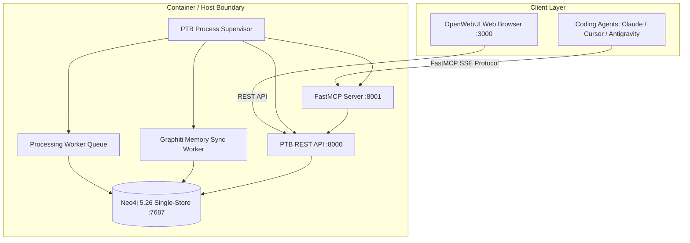

# Hướng Dẫn Triển Khai Hệ Thống Personal Task Board (PTB) — Production Ready

Tài liệu này hướng dẫn chi tiết quy trình triển khai Personal Task Board (PTB) v1 phục vụ môi trường sản xuất (Production Deployment) theo chuẩn Docker Container và Bare-metal Process Supervisor.

---

## 1. Kiến Trúc Triển Khai (Deployment Architecture)



---

## 2. Yêu Cầu Hệ Thống (Prerequisites)

- **Hệ điều hành**: Linux (Ubuntu 22.04+ / Debian 12+), macOS (Apple Silicon / Intel), hoặc Windows 11 / Server (WSL2 / Docker Desktop).
- **RAM**: Tối thiểu 4 GB (Khuyến nghị 8 GB trở lên nếu kích hoạt embedding model hoặc LLM cục bộ).
- **Phần mềm**:
  - Docker Engine v24.0+ và Docker Compose v2.20+
  - Python 3.11, 3.12 hoặc 3.13 (nếu triển khai Bare-metal)
  - `uv` package manager (khuyến nghị để cài đặt dependency trong 2-5 giây)
- **Cổng mạng (Ports)**:
  - `7687` (Bolt protocol - Neo4j)
  - `7474` (Neo4j Browser UI)
  - `8000` (PTB REST API & Ingestion Webhooks)
  - `8001` (FastMCP Server SSE)
  - `3000` (OpenWebUI Interface)

---

## 3. Triển Khai Nhanh Bằng Docker Compose (Khuyến Nghị)

### Bước 1: Chuẩn bị biến môi trường
Sao chép file cấu hình mẫu và điền thông tin:
```bash
cp .env.example .env
```

Thiết lập các biến quan trọng trong `.env`:
```ini
# Neo4j Database
NEO4J_PASSWORD=your_strong_password_here
NEO4J_URI=bolt://neo4j:7687

# LLM Provider (Hỗ trợ OpenAI, Gemini, hoặc OpenAI-compatible API)
LLM_PROVIDER=openai_compatible
LLM_BASE_URL=https://generativelanguage.googleapis.com/v1beta/openai
LLM_API_KEY=your_llm_api_key_here
LLM_MODEL=gemini-2.5-flash

# Cổng dịch vụ
PTB_HOST=0.0.0.0
PTB_PORT=8000
PTB_MCP_PORT=8001
```

### Bước 2: Khởi chạy toàn bộ dịch vụ (Single-Command Launch)
Khởi chạy bộ dịch vụ chuẩn (Neo4j, PTB Process Supervisor, OpenWebUI):
```bash
docker compose up -d --build
```
*Hoặc khởi chạy cấu hình production chuyên dụng:*
```bash
docker compose -f docker-compose.prod.yml up -d --build
```

Container `ptb-app` sẽ tự động:
1. Đợi Neo4j khởi động và kiểm tra kết nối (`healthcheck`).
2. Tự động chạy `ptb init` áp dụng đầy đủ Cypher Schema Constraints & Performance Indexes.
3. Khởi chạy `PTBProcessSupervisor` đồng thời trên cổng `8000` (REST) và `8001` (FastMCP).

### Bước 3: Kiểm tra sức khỏe hệ thống (Health Check)
Kiểm tra container logs:
```bash
docker compose logs -f ptb-app
```

Kiểm tra HTTP Health Check:
```bash
curl -f http://127.0.0.1:8000/health
# Kết quả mong đợi: {"status":"healthy","service":"ptb-application",...}
```

Kiểm tra chi tiết tình trạng subsystems:
```bash
docker compose exec ptb-app python scripts/ptb_cli.py doctor
```

---

## 4. Triển Khai Bare-Metal / Cục Bộ (Local Supervision)

### Bước 1: Khởi động Neo4j
```bash
docker compose up -d neo4j
```

### Bước 2: Khởi tạo schema và constraints
```bash
uv run python scripts/ptb_cli.py init
```

### Bước 3: Đăng nhập Microsoft 365 (Tùy chọn nếu thu thập Teams / Outlook Web)
```bash
uv run python scripts/ptb_cli.py login microsoft
```

### Bước 4: Khởi động Process Supervisor
```bash
uv run python scripts/ptb_cli.py run
```
Supervisor sẽ tự động bind:
- REST API: `http://127.0.0.1:8000`
- FastMCP SSE: `http://127.0.0.1:8001/sse`
- Ingestion Adapters: Coding Agents, Git, Jira, Shortcut, Confluence, GitHub, Slack
- Processing Worker: Quét và phân loại RawEvents
- Graph Memory Sync Worker: Tự động đồng bộ Episodic Memory

---

## 5. Cấu Hình MCP Cho Coding Agents (Claude, Cursor, Antigravity)

PTB cung cấp bộ công cụ FastMCP 19 tools đầy đủ cho trợ lý lập trình.

### 5.1 Claude Desktop
Thêm vào file cấu hình `claude_desktop_config.json`:
```json
{
  "mcpServers": {
    "personal-task-board": {
      "command": "python",
      "args": ["-m", "scripts.ptb_cli", "mcp", "--serve-fastmcp"]
    }
  }
}
```

### 5.2 Cursor / Antigravity MCP Setting
- **Protocol**: SSE / FastMCP
- **URL**: `http://127.0.0.1:8001/sse`
- **Capabilities**: Read-Only (10 tools) hoặc Full Lifecycle (19 tools).

---

## 6. Bảo Trì, Sao Lưu & Giám Sát (Maintenance & Disaster Recovery)

### 6.1 Sao lưu dữ liệu Neo4j
Toàn bộ dữ liệu Domain Entity và Graphiti Memory được lưu tại volume `neo4j_data`:
```bash
docker run --rm -v ptb_neo4j_data:/data -v $(pwd):/backup alpine tar czvf /backup/neo4j_backup.tar.gz /data
```

### 6.2 Phục hồi dữ liệu
```bash
docker run --rm -v ptb_neo4j_data:/data -v $(pwd):/backup alpine tar xzvf /backup/neo4j_backup.tar.gz -C /
```

### 6.3 Bảng mã BugCode và xử lý sự cố
| BugCode | Mô tả | Hướng khắc phục |
|---|---|---|
| `PTB_STORAGE_001` | Mất kết nối Neo4j authoritative store | Kiểm tra container Neo4j (`docker compose ps neo4j`) và credentials trong `.env` |
| `PTB_LLM_001` | Chưa cấu hình hoặc lỗi kết nối LLM provider | Kiểm tra `LLM_API_KEY` và `LLM_BASE_URL` trong `.env` qua `ptb doctor --deep` |
| `PTB_GRAPH_001` | Lỗi Graphiti semantic memory worker | Chạy `ptb graph rebuild` để đồng bộ lại từ Neo4j domain data |
| `PTB_OWUI_001` | OpenWebUI artifact board HTML không tìm thấy | Kiểm tra file mount `./data/openwebui` và phân quyền người dùng |
