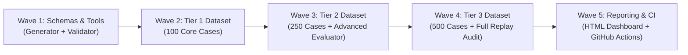

# ĐẶC TẢ NHIỆM VỤ: XÂY DỰNG BỘ KIỂM CHUẨN PTB-BENCH-500 (500 BENCHMARK SAMPLES)
> **Dự án:** Personal Task Board (PTB)  
> **Mã nhiệm vụ:** `TASK-BENCH-500`  
> **Thư mục triển khai:** [d:\Working\PTB\Evaluation](file:///d:/Working/PTB/Evaluation)  
> **Dự án mục tiêu:** [d:\Working\PTB\Personal_Task_Board-main](file:///d:/Working/PTB/Personal_Task_Board-main)  
> **Quy mô:** 500 Benchmark Cases (475 RawEvents + 25 Failure/Recovery Probes)  
> **Trạng thái:** 🎯 SẴN SÀNG TRIỂN KHAI (READY FOR IMPLEMENTATION)

---

## 1. MỤC TIÊU VÀ NGUYÊN TẮC CỐT LÕI

### 1.1 Mục Tiêu Tối Thượng
Xây dựng bộ dữ liệu kiểm chuẩn quy mô công nghiệp **PTB-Bench-500** gồm **500 mẫu có nhãn chuẩn xác (Ground Truth Oracle)** nhằm đánh giá toàn diện năng lực trích xuất, lọc nhiễu, liên kết đa nguồn, suy luận ưu tiên và khả năng phục hồi lỗi của hệ thống Personal Task Board từ Layer 1 đến Layer 5.

### 1.2 Bốn Nguyên Tắc Bất Biến (Non-Negotiable Guardrails)
1. **Tất Định Tuyệt Đối (100% Deterministic — Zero LLM-as-a-judge):** Mọi quyết định đánh giá PASS/FAIL đều đối chiếu toán học với Ground Truth Oracle; tuyệt đối không sử dụng LLM để chấm điểm kết quả.
2. **Bảo Đảm Bất Biến Lặp Lại (Idempotency Replay Loop):** Khi phát lại (replay) toàn bộ 500 sự kiện lần thứ 2 trên cùng database, hệ thống **không được phép tạo thêm bất kỳ task trùng lặp nào** (`duplicate_tasks_created == 0`).
3. **Bảo Toàn Nguồn Gốc Đồ Thị (100% Graph Provenance Lineage):** Mọi task được tạo ra phải có liên kết `:HAS_EVIDENCE` trỏ về RawEvent gốc, `orphan_tasks == 0`.
4. **Ẩn Danh Hóa Tuyệt Đối (100% PII Sanitized):** Toàn bộ dữ liệu logs thật phải được làm sạch thông tin cá nhân (email, token, credential, tên riêng nhạy cảm) trước khi đưa vào dataset.

---

## 2. MA TRẬN PHÂN BỔ DỮ LIỆU (500 SAMPLES MATRIX)

Dataset 500 mẫu được tổ chức phân tầng theo 2 chiều: **Nguồn Dữ Liệu (Source)** và **Nhóm Bài Toán (Taxonomy Challenge)**.

### 2.1 Phân Bổ Theo Nguồn Dữ Liệu (Sources Distribution)

| STT | Nguồn Dữ Liệu (Source Type) | Tỷ Lệ (%) | Số Lượng Mẫu | Mô Tả & File Dữ Liệu Đích |
| :---: | :--- | :---: | :---: | :--- |
| **1** | **Microsoft Teams** (`ms_teams`) | 30% | **150 events** | Chat 1-1, Channel thảo luận, Thread quote-reply lồng nhau (`sources/teams_events.json`) |
| **2** | **AI Coding Agents** (`coding_agent`) | 25% | **125 events** | Sessions từ Antigravity, Cursor, OpenAI Codex, Cline, Windsurf (`sources/agent_events.json`) |
| **3** | **Microsoft Outlook** (`ms_outlook`) | 15% | **75 events** | Email đơn, Email Re: thread thảo luận, Email Forward chỉ đạo (`sources/outlook_events.json`) |
| **4** | **Git Repositories** (`git`) | 15% | **75 events** | Commit messages, PR descriptions, PR inline review comments (`sources/git_events.json`) |
| **5** | **Issue Trackers** (`jira`, `shortcut`) | 10% | **50 events** | Jira bug tickets, Shortcut stories, comment cập nhật trạng thái (`sources/issue_events.json`) |
| **6** | **Failure & Recovery Probes** | 5% | **25 probes** | Kịch bản tiêm lỗi mạng, auth, database, LLM timeout (`probes/probes_manifest.json`) |
| **TỔNG** | **TOÀN BỘ DATASET** | **100%** | **500 cases** | **475 RawEvents + 25 Failure Probes** |

---

### 2.2 Phân Bổ Theo Nhóm Bài Toán Kiểm Thử (Taxonomy Challenge Classes)

```text
┌────────────────────────────────────────────────────────────────────────┐
│ PHÂN BỔ 500 CASES THEO THÁCH THỨC ĐÁNH GIÁ (CHALLENGE TAXONOMY)         │
├───────┬──────────────────────────────────┬───────────┬─────────────────┤
│ Class │ Tên Phân Lớp Thách Thức          │ Số Lượng  │ Mục Tiêu Đo     │
├───────┼──────────────────────────────────┼───────────┼─────────────────┤
│ CL-A  │ Direct Actionable Task           │ 140 cases │ Recall & Extrac │
│ CL-B  │ Noise & Chatter Rejection        │ 130 cases │ Heuristic Filter│
│ CL-C  │ Multi-turn & Quote-Reply Parsing │ 75 cases  │ Parser L2       │
│ CL-D  │ Complex Attribution & Identity   │ 50 cases  │ Person Resolver │
│ CL-E  │ Correlation & Cross-Source Merge │ 45 cases  │ Candidate Merger│
│ CL-F  │ Adversarial & Negation / Cancel  │ 35 cases  │ Anti-Hallucinat │
│ CL-G  │ Failure & Recovery Probes        │ 25 probes │ Resilience L1-L4│
└───────┴──────────────────────────────────┴───────────┴─────────────────┘
```

#### Chi Tiết Từng Phân Lớp:
1. **Class A: Direct Actionable Task (140 cases - 28%):**
   - Tin nhắn giao việc rõ ràng, cam kết chắc chắn ("em sẽ fix lỗi này trước 17h", "nhờ anh review PR #42").
   - *Yêu cầu Oracle:* `is_task = true`, trích xuất đúng title, owner, requester, deadline ISO.
2. **Class B: Noise & Chatter Rejection (130 cases - 26%):**
   - Chào hỏi buổi sáng, thông báo nội bộ, meme, thảo luận phi hành động, câu hỏi kỹ thuật không phát sinh task.
   - *Yêu cầu Oracle:* `is_task = false`. [HeuristicCandidateFilter](file:///d:/Working/PTB/Personal_Task_Board-main/services/processing/src/ptb_processing/extractor/heuristic_filter.py) phải loại bỏ ít nhất 75% số này mà không tốn chi phí gọi LLM.
3. **Class C: Multi-turn & Quote-Reply (75 cases - 15%):**
   - Hội thoại nhiều lượt, câu trả lời nằm sau thẻ blockquote của người khác.
   - *Yêu cầu Oracle:* [TeamsQuoteReplyParser](file:///d:/Working/PTB/Personal_Task_Board-main/services/processing/src/ptb_processing/parsers/quote_reply.py) bóc tách chính xác `actual_author` và `actual_content_text`.
4. **Class D: Complex Attribution & Ambiguous Identity (50 cases - 10%):**
   - Giao việc cho bên thứ ba ("nhờ anh Cuong chuyển lời cho Nam"), tên hiển thị viết tắt, nhiều người cùng tên.
   - *Yêu cầu Oracle:* Phân biệt chính xác giữa `owner` (người chịu trách nhiệm làm) và `requester` (người giao việc).
5. **Class E: Correlation & Cross-Source Merging (45 cases - 9%):**
   - Cùng 1 lỗi (vd: OPS-88 hoặc BUG-204) xuất hiện đồng thời trên Teams, Jira ticket, Git commit và Cursor session.
   - *Yêu cầu Oracle:* [TaskMerger](file:///d:/Working/PTB/Personal_Task_Board-main/services/processing/src/ptb_processing/correlation/merger.py) phải gộp các sự kiện liên quan thành **1 task duy nhất** với nhiều evidences, False Merge Rate = 0%.
6. **Class F: Adversarial & Negation / Cancellation (35 cases - 7%):**
   - Câu có từ khóa nhưng mang nghĩa phủ định ("Hôm nay hủy release, không cần deploy nữa", "Đừng sửa file này").
   - *Yêu cầu Oracle:* `is_task = false`, ngăn chặn LLM hallucination tự động sinh task rác.
7. **Class G: Failure & Recovery Probes (25 probes - 5%):**
   - 25 kịch bản lỗi tiêm có chủ đích: LLM Timeout (500), LLM JSON vỡ, Idempotency conflict, Neo4j Socket Down, Playwright Auth 401/403, Rate limit 429, Git malformed commit.
   - *Yêu cầu Oracle:* Hệ thống ghi nhận mã log chuẩn (`PTB-LLM-001`, `PTB-STORAGE-001`, `PTB-L1-001`), fail-fast an toàn, không có silent fallback.

---

## 3. CẤU TRÚC BÀN GIAO THƯ MỤC DỮ LIỆU ĐÍCH

Toàn bộ bộ kiểm chuẩn mới sẽ được đặt tại:
`d:\Working\PTB\Evaluation\benchmarks\dataset\ptb_500\`

```text
d:\Working\PTB\Evaluation\benchmarks\dataset\ptb_500\
├── manifest.json                       # Định danh, hash SHA-256, schema gate, metrics tổng
├── sources/
│   ├── teams_events.json               # 150 RawEvents từ MS Teams
│   ├── agent_events.json               # 125 RawEvents từ Coding Agents (Cursor, Antigravity, Codex,...)
│   ├── outlook_events.json             # 75 RawEvents từ Outlook Email
│   ├── git_events.json                 # 75 RawEvents từ Git commits & PRs
│   └── issue_events.json               # 50 RawEvents từ Jira & Shortcut
├── probes/
│   └── probes_manifest.json            # 25 Failure & Recovery Probes đặc tả chi tiết
└── ground_truth/
    └── oracle.json                     # 500 nhãn Ground Truth Oracle tất định 100%
```

---

## 4. QUY CHUẨN KỸ THUẬT VÀ SCHEMA CONTRACTS

### 4.1 Schema Bản Ghi Sự Kiện (`RawEventRecord`)
Mọi event trong `sources/*.json` bắt buộc tuân thủ schema Pydantic [RawEventRecord](file:///d:/Working/PTB/Personal_Task_Board-main/packages/contracts/src/ptb_contracts/l1_acquisition.py#L72):
```json
{
  "id": "b1d3f5a0-0001-4a8b-9a2c-1f8e7d6c0001",
  "tenant_id": "tenant-benchmark-500",
  "source_type": "ms_teams",
  "external_id": "teams-msg-10001",
  "parent_external_id": null,
  "idempotency_key": "SHA256_DETERMINISTIC_HASH",
  "event_timestamp": "2026-10-14T08:30:00.000Z",
  "captured_at": "2026-10-14T08:30:01.000Z",
  "author_external_id": "user-cuong-dam",
  "author_display_name": "Dam Quang Cuong",
  "conversation_or_project_id": "channel-devops-core",
  "deep_link": "https://teams.microsoft.com/l/message/channel-devops-core/10001",
  "raw_payload": { ... },
  "payload_json": "{ ... }",
  "normalized_text": "Em sẽ kiểm tra lỗi memory leak trước 17h hôm nay.",
  "content_hash": "SHA256_NORMALIZED_TEXT",
  "processing_status": "pending",
  "retry_count": 0,
  "processing_attempt_count": 0
}
```

### 4.2 Schema Ground Truth Oracle Mở Rộng (`oracle.json`)
Mỗi bản ghi trong `oracle.json` có định dạng:
```json
{
  "case_id": "TC-500-001",
  "external_id": "teams-msg-10001",
  "source_type": "ms_teams",
  "challenge_class": "CL-A-DIRECT-TASK",
  "is_task": true,
  "rejection_reason": null,
  "expected_task": {
    "title": "Kiểm tra lỗi memory leak",
    "owner": "Dam Quang Cuong",
    "requester": "Tran Van Lead",
    "deadline": "2026-10-14T17:00:00+07:00",
    "anchor_cluster_key": "MEM-LEAK-01",
    "expected_status": "TODO",
    "confidence_threshold": 0.85,
    "merge_with_external_ids": ["git-commit-c9812a"],
    "evidence_snippet": "Em sẽ kiểm tra lỗi memory leak trước 17h hôm nay."
  },
  "verification_rules": {
    "require_exact_owner": true,
    "require_deadline_match": true,
    "require_evidence_grounding": true,
    "allow_false_merge": false
  }
}
```

---

## 5. NGUỒN KHAI THÁC & CÔNG CỤ SINH DỮ LIỆU BÁN TỰ ĐỘNG

Nhằm tạo 500 cases thực tế, chất lượng cao mà không tốn công gõ thủ công, sử dụng các nguồn có sẵn trong workspace:
1. **Dữ liệu Coding Agents:** Tận dụng công cụ [agent_data_exporter.py](file:///d:/Working/PTB/agent_data_exporter.py) và tệp logs thật [agent_sft_dataset.jsonl](file:///d:/Working/PTB/agent_sft_dataset.jsonl) cùng thư mục [raw_samples](file:///d:/Working/PTB/raw_samples) (Antigravity, Cursor, Codex).
2. **Dữ liệu Microsoft:** Kế thừa mẫu từ [tests/fixtures/teams_messages_fixture.json](file:///d:/Working/PTB/Personal_Task_Board-main/tests/fixtures/teams_messages_fixture.json) và [outlook_messages_fixture.json](file:///d:/Working/PTB/Personal_Task_Board-main/tests/fixtures/outlook_messages_fixture.json).
3. **Xây dựng Script Sinh Dữ Liệu Bán Tự Động:**
   Tạo file `Evaluation/benchmarks/tools/dataset_generator.py` để:
   - Tự động sinh `idempotency_key` bằng SHA-256.
   - Làm sạch PII (Sanitize email, tên công ty nhạy cảm).
   - Tự động kiểm tra tính nhất quán giữa `sources/*.json` và `ground_truth/oracle.json`.

---

## 6. PHÂN RÃ CÔNG VIỆC THỰC HIỆN (TASK WORK BREAKDOWN STRUCTURE - WBS)

Quá trình xây dựng được chia thành **5 Wave tuần tự**:



### Chi Tiết Từng Wave:

### WAVE 1: XÂY DỰNG SCHEMA MỞ RỘNG & CÔNG CỤ TỰ ĐỘNG HÓA
- [ ] **Task 1.1: Mở rộng Manifest & Oracle Data Model**
  - Cập nhật Pydantic models trong `Evaluation/benchmarks/dataset/` để hỗ trợ trường `challenge_class`, `verification_rules`, phân loại 6 nguồn dữ liệu.
- [ ] **Task 1.2: Xây dựng Bộ sinh dữ liệu & Kiểm chuẩn PII (`benchmarks/tools/dataset_generator.py`)**
  - Script trích xuất logs từ `raw_samples/`, áp dụng regex sinh SHA-256 idempotency key và mask toàn bộ thông tin nhạy cảm.

### WAVE 2: HOÀN THIỆN DATASET TIER 1 (100 CORE CASES)
- [ ] **Task 2.1: Thu hoạch & Chuẩn hóa 100 RawEvents đầu tiên**
  - 30 Teams + 25 Agents + 15 Outlook + 15 Git + 10 Jira/Shortcut + 5 Probes.
- [ ] **Task 2.2: Gán nhãn Oracle và nghiệm thu Gate Wave 2**
  - Gán nhãn 100% tất định cho 100 cases trong `ground_truth/oracle.json`. Nghiệm thu 0 nhãn `AMBIGUOUS`.
- [ ] **Task 2.3: Nâng cấp Benchmark Runner & Replay Batching**
  - Nâng cấp [ReplayEngine](file:///d:/Working/PTB/Evaluation/benchmarks/runner/replay_engine.py) để chạy 100 cases trong < 15 giây với bộ nhớ đệm RAM.

### WAVE 3: MỞ RỘNG DATASET TIER 2 (250 CASES) & NÂNG CẤP EVALUATOR
- [ ] **Task 3.1: Mở rộng 150 Cases phức tạp**
  - Bổ sung 50 cases Class C (Quote-reply), 35 cases Class D (Attribution) và 30 cases Class E (Correlation & Merging).
- [ ] **Task 3.2: Nâng cấp Evaluator với Ma trận Đo lường Chuyên Sâu**
  - Nâng cấp [DeterministicComparator](file:///d:/Working/PTB/Evaluation/benchmarks/evaluator/deterministic.py) đo thêm:
    + **False Merge Rate (FMR):** Tỷ lệ task độc lập bị gộp nhầm.
    + **Missed Merge Rate (MMR):** Tỷ lệ task cùng thread nhưng bị tách rời.
    + **Noise Rejection Rate:** Tỷ lệ lọc tin rác thành công.

### WAVE 4: HOÀN THÀNH TOÀN DIỆN DATASET TIER 3 (500 CASES)
- [ ] **Task 4.1: Bổ sung 250 Cases còn lại (Noise & Adversarial)**
  - Bổ sung 100 cases Class B (Noise/Chatter), 25 cases Class F (Negation) và 15 Probes tiêm lỗi nâng cao.
- [ ] **Task 4.2: Thực thi Toàn Trình Clean Run & Idempotency Replay Run**
  - Chạy `uv run python -m benchmarks.cli --dataset-dir benchmarks/dataset/ptb_500`.
  - Nghiệm thu: 100% cases chạy qua pipeline, 0 duplicate task khi replay.

### WAVE 5: XUẤT BÁO CÁO TRỰC QUAN & TÍCH HỢP CI/CD
- [ ] **Task 5.1: Xây dựng Báo cáo Dashboard HTML Hiện Đại**
  - Cập nhật [ReportGenerator](file:///d:/Working/PTB/Evaluation/benchmarks/evaluator/reporter.py) để xuất song song `reports/benchmark_ptb_500.md` và `reports/benchmark_ptb_500.html` (chứa biểu đồ phân bổ lỗi và bộ lọc tương tác).
- [ ] **Task 5.2: Tích hợp vào GitHub Actions CI Pipeline**
  - Cấu hình workflow tự động kích hoạt Tier 1 trên mọi Pull Request và Tier 3 trên nightly release builds.

---

## 7. TIÊU CHÍ NGHIỆM THU CUỐI CÙNG (FINAL ACCEPTANCE GATES)

Bộ kiểm chuẩn **PTB-Bench-500** chỉ được coi là hoàn tất khi đạt toàn bộ các chỉ số sau:
1. **Tổng số mẫu:** Đúng **500 cases** (475 RawEvents + 25 Probes), `manifest.json` có mã hash kiểm tra hợp lệ.
2. **Không có nhãn mâu thuẫn:** 100% các sample trong Oracle có đầy đủ thuộc tính, 0 nhãn bị bỏ trống hoặc xung đột logic.
3. **Chỉ số chất lượng kiểm chuẩn (Target Scorecard Bar):**
   - **Precision (Độ chính xác trích xuất):** $\ge 92.0\%$
   - **Recall (Độ phủ phát hiện task):** $\ge 90.0\%$
   - **F1 Score:** $\ge 91.0\%$
   - **Owner Attribution Accuracy:** $\ge 88.0\%$
   - **Deadline Detection Accuracy:** $\ge 85.0\%$
   - **False Merge Rate (FMR):** $= 0.0\%$ (Tuyệt đối không gộp nhầm task)
   - **Graph Provenance Lineage:** $100\%$ hợp lệ, 0 task mồ côi.
   - **Idempotency Replay Duplicates:** $= 0$ (Không sinh thêm task khi replay).

---

## 8. LỆNH THỰC THI & KIỂM TRA

```powershell
# 1. Kiểm tra tính toàn vẹn của dataset và manifest
uv run python -m benchmarks.tools.validate_manifest --dataset ptb_500

# 2. Chạy kiểm thử toàn bộ 500 cases qua CLI
uv run python -m benchmarks.cli --dataset-dir benchmarks/dataset/ptb_500 --output-report reports/benchmark_ptb_500.md

# 3. Chạy kiểm thử từng tầng L1 đến L5 độc lập với bộ 500 cases
uv run pytest benchmarks/modules -v --dataset ptb_500
```
