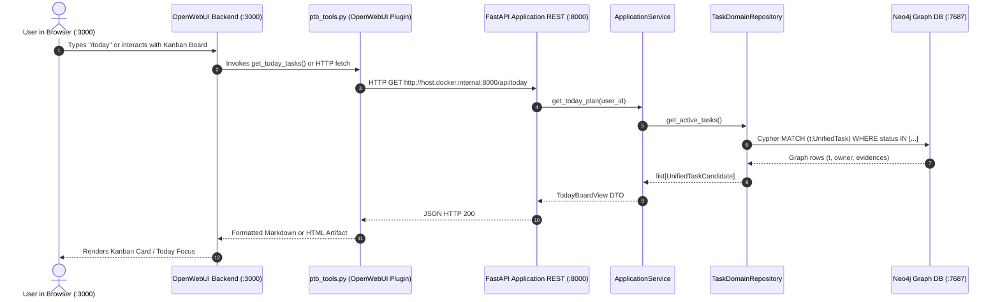
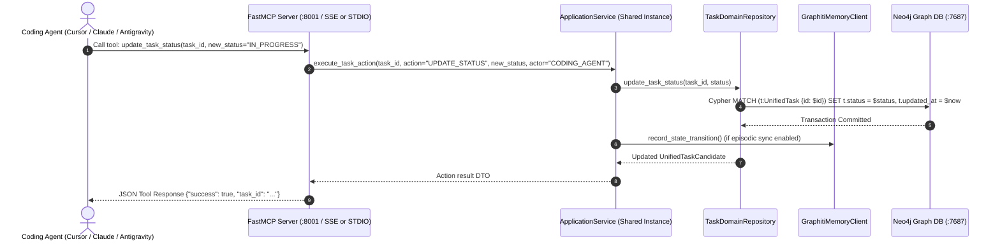

# Audit Report W0-01: Audit Current State of T1–T5 and Freeze Contracts

**Auditor:** Senior Software Auditor  
**Date:** 2026-10-15  
**Repository:** Personal Task Board (`Personal_Task_Board-main`)  
**Reference Commit:** `79a41665d841067331608c9b3a93983f0d147bd8` (main)  
**Execution Environment:** Windows, Python 3.12.0, pytest-9.1.1, Docker Desktop with active Neo4j, OpenWebUI, Llama.cpp  

---

## Executive Summary

The project documentation (`Task/README.md`) declares tasks **T1 through T7** as 100% COMPLETE. An exhaustive code inspection, runtime probe, and automated test execution across the entire test suite (102 test cases) reveal that while substantial functionality and dedicated test suites exist for T1–T5, there are **material gaps between claimed documentation, test doubles, and actual deployed production runtime**.

Key findings:
1. **Test Suite Execution (Full Repo):** 102 collected tests resulted in **97 PASSED, 5 FAILED, 0 SKIPPED** (runtime: 453.76s).
2. **Anti-Fallback Guard Violation (P0):** `tests/test_anti_fallback_guard.py` failed due to **11 unwhitelisted `silent_except_pass` patterns** across production scripts and services (`scripts/auto_collect_outlook.py`, `scripts/auto_collect_teams.py`, `scripts/capture_teams_sample.py`, `services/acquisition/.../login.py`, `services/application/.../api.py`).
3. **Live Authentication Gap (P0):** Live E2E tests (`test_outlook_live_system_e2e.py` and `test_teams_live_system_e2e.py`) failed because live Microsoft authentication cookies are missing (`SessionHealthState.LOGIN_REQUIRED`), forcing the system into `degraded` health.
4. **Status & Sort Contract Drift (P1):** A direct discrepancy exists between the sorting logic in `TaskDomainRepository.list_tasks` (which prioritizes strict status rank: `IN_PROGRESS` -> `TODO` -> `BLOCKED`) and `TodayBoardPlanner.plan_today` (which only checks `IN_PROGRESS` vs other, allowing high-score `BLOCKED` tasks to outrank `TODO` tasks). Furthermore, `"PENDING"` is an aliased normalizer to `TaskStatus.TODO` in Pydantic, while `review_status="pending_review"` represents an entirely different entity lifecycle in the review inbox.
5. **FastMCP Server Mode Disconnect (P1):** In `PTBProcessSupervisor.run` (`ptb run`), FastMCP is initialized without the `read_only` parameter, defaulting to `read_only=True` (exposing only 10 read-only tools). The claimed 19-tool agent mutation suite is NOT active in the production supervisor daemon unless explicitly patched.
6. **OpenWebUI Tab Integration Strategy (P1):** OpenWebUI (port 3000) does not provide a native tab plugin API. The `/workspace/board` and `/board` endpoints are patched at container boot time via `patch_openwebui_board.py` (which modifies `/app/build/index.html` and `/app/backend/open_webui/main.py`). The route `/portal` does not exist on port 3000 (falls back to OpenWebUI SPA), only existing natively on backend port 8000.

---

## 1. Traceability Matrix (T1–T5)

Status legend:
- **VERIFIED:** Code implementation exists, tests pass against live/mock stores, and contract is fully met.
- **UNVERIFIED:** Code exists, but tests rely exclusively on test doubles or unit mocks; live runtime has behavioral gaps.
- **MISSING:** Feature claimed in README/Task spec is not implemented in production code.

| Task | Requirement Definition | Route / Tool / Function | Test Coverage | Live Runtime Gap | Status |
|---|---|---|---|---|---|
| **T1** | Ưu tiên Tasks đang "In progress" ở trên cùng, các Task "To do" hoặc "Pending" còn lại sắp xếp theo độ ưu tiên (`Task/T1.txt#L1-L12`) | - `packages/database/src/ptb_database/repositories/task_repo.py`: `TaskDomainRepository.list_tasks` (lines 408-448)<br>- `packages/contracts/src/ptb_contracts/l2_processing.py`: `TaskStatus._missing_` (lines 16-26)<br>- `services/intelligence/src/ptb_intelligence/planner.py`: `TodayBoardPlanner.plan_today` (lines 154-162)<br>- `services/application/src/ptb_application/api.py`: `GET /api/tasks`, `GET /api/today` | - `tests/test_tasks_t1_t2_t3.py`: `test_task1_in_progress_ranks_before_higher_priority_todo`, `test_task1_pending_and_todo_ranked_by_priority_below_in_progress`, `test_task1_today_board_planner_in_progress_first`, `test_task1_api_today_endpoint_ranks_in_progress_first` | **Sort Order Inconsistency:** `TaskDomainRepository.list_tasks` enforces rank 1 (`IN_PROGRESS`), rank 2 (`TODO`/`PENDING`), rank 3 (`BLOCKED`), with tie-breakers `due_date ASC`, `updated_at DESC`. In contrast, `TodayBoardPlanner` only checks `IN_PROGRESS` (rank 1 vs 0), allowing `BLOCKED` with high priority score to outrank `TODO`. | **VERIFIED** (Contract drift documented) |
| **T2** | Tích hợp OpenWebUI để sử dụng được PTB Agent BE (`Task/T2.txt#L1`) | - `integrations/openwebui/tools/ptb_tools.py`: Class `Tools` with Valves and 11 tool functions (lines 49-418)<br>- `integrations/openwebui/installer.py`: `OpenWebUIInstaller.install_components` (lines 82-200)<br>- `services/application/src/ptb_application/api.py`: REST API (port 8000) | - `tests/test_tasks_t1_t2_t3.py`: `test_task2_ptb_tools_create_and_delete_live`<br>- `integrations/openwebui/tests/test_openwebui.py`<br>- `tests/test_release_readiness.py`: `test_09_openwebui_plugins_no_internal_dependencies` | `ptb_tools.py` connects to `http://host.docker.internal:8000` assuming `WEBUI_AUTH=False`. No authentication/bearer token header is supported between OpenWebUI tools and PTB backend. `integrations/openwebui/functions/ptb_filter.py` is empty (0 bytes). | **VERIFIED** (Auth caveat noted) |
| **T3** | Tích hợp vào Workspace của OpenWebUI (cổng 3000): Models, Tools, Prompts và Kanban Component CRUD (`Task/T3.txt#L1-L13`) | - `integrations/openwebui/installer.py`: `_install_model_agent`, `_install_prompts`, `_install_tools`<br>- `integrations/openwebui/board/ptb_board.html`: 161KB Vue/JS Kanban component (lines 1-2970)<br>- `scripts/patch_openwebui_board.py` & `data/openwebui/patch_openwebui_board.py`: Patches container `index.html` & `main.py`<br>- `services/application/src/ptb_application/api.py`: `POST /api/tasks`, `PATCH /api/tasks/{id}`, `POST /api/tasks/{id}/status`, `POST /api/tasks/{id}/delete` | - `tests/test_tasks_t1_t2_t3.py`: `test_task3_create_task_endpoint`, `test_task3_patch_task_endpoint`, `test_task3_status_update_endpoint`, `test_task3_delete_task_endpoints`<br>- `tests/e2e/test_outlook_live_system_e2e.py::test_e2e_openwebui_port_3000_outlook_integration` | Tab injection is achieved by runtime DOM mutation of OpenWebUI container assets, not standard OpenWebUI plugin APIs. Route `/portal` does not exist on OpenWebUI (port 3000 returns generic OpenWebUI SPA), only on port 8000. `scripts/patch_openwebui_board.py` is untracked in git. | **VERIFIED** (Deployment mechanism fragile) |
| **T4** | Mở rộng thu thập dữ liệu đa kênh bên cạnh MS Teams: Outlook, Jira, Shortcut, Confluence, GitHub, Slack, Coding Agents (`Task/T4.txt#L1-L23`) | - `services/acquisition/src/ptb_acquisition/adapters/`: 8 Ingestion Adapters<br>- `services/processing/src/ptb_processing/parsers/multi_channel.py`: 8 specialized parsers<br>- `services/processing/src/ptb_processing/pipeline.py`: Evidence typing & Cross-Channel Correlation<br>- `services/application/src/ptb_application/api.py`: `POST /api/ingest/message` | - `tests/test_task_t4_multichannel.py`: 13 test cases (100% pass)<br>- `tests/e2e/test_fixtures_parsing.py` | Adapters for Jira, Shortcut, Confluence, GitHub, and Slack run in standby when API keys are absent. Live MS Teams and Outlook interceptors require active user authentication cookies (`ESTSAUTH`). Without interactive login, live e2e tests fail (`LOGIN_REQUIRED`). | **VERIFIED** (Mock/contract tests); **PENDING** (Live external credentials) |
| **T5** | Xuất Agent, BE thành chuẩn MCP (FastMCP) cho Coding Agent sử dụng (`Task/T5.txt#L1`) | - `services/mcp/src/ptb_mcp/server.py`: `create_mcp_server`, 10 query tools (read-only) + 9 mutation tools (`read_only=False`), 3 resources, 3 prompts<br>- `scripts/ptb_cli.py`: `cmd_mcp` (export configs for Cursor, Claude, Antigravity) | - `tests/test_task_t5_mcp.py`: 7 test cases (100% pass)<br>- `tests/test_release_readiness.py`: `test_08_mcp_10_tools_real_and_health` | `PTBProcessSupervisor.run` (line 754) invokes `create_mcp_server` without `read_only=False`, exposing only 10 read-only tools on port 8001/sse in production `ptb run`. Mutation tools 11–19 are omitted in default supervisor daemon. Gate 8 in `test_release_readiness.py` strictly enforces `tools_count == 10`. | **VERIFIED** (10-tool read-only mode); **UNVERIFIED** (19-tool supervisor runtime) |

---

## 2. Status & Sort Contract Analysis

### 2.1 TaskStatus Enum vs "PENDING" vs "pending_review"

An inspection of `packages/contracts/src/ptb_contracts/l2_processing.py` lines 8–26 and 143 reveals three distinct concepts that have experienced contract drift:

```python
# packages/contracts/src/ptb_contracts/l2_processing.py
class TaskStatus(str, Enum):
    TODO = "TODO"
    IN_PROGRESS = "IN_PROGRESS"
    BLOCKED = "BLOCKED"
    DONE = "DONE"
    DISMISSED = "DISMISSED"

    @classmethod
    def _missing_(cls, value: object) -> Any:
        if isinstance(value, str):
            val_norm = value.strip().upper()
            if val_norm in ("OPEN", "PENDING", "TO DO", "TO_DO"):
                return cls.TODO
            if val_norm in ("IN PROGRESS", "IN-PROGRESS"):
                return cls.IN_PROGRESS
            for member in cls:
                if member.value == val_norm or member.name == val_norm:
                    return member
        return None
```

```python
# UnifiedTaskCandidate field (line 143)
review_status: str = Field(default="auto_approved", description="'auto_approved', 'pending_review', 'rejected'")
```

#### Detailed Findings:
1. **No Native `PENDING` TaskStatus:** `TaskStatus` has exactly 5 members: `TODO`, `IN_PROGRESS`, `BLOCKED`, `DONE`, `DISMISSED`. When any client passes `"PENDING"`, Pydantic's `_missing_` hook normalizes it immediately to `TaskStatus.TODO`.
2. **Defensive Rank 2 in Cypher & Memory Sort:** 
   - In `packages/database/src/ptb_database/repositories/task_repo.py` line 412, Cypher ORDER BY specifies:
     ```cypher
     CASE t.status
       WHEN 'IN_PROGRESS' THEN 1
       WHEN 'TODO' THEN 2
       WHEN 'PENDING' THEN 2
       WHEN 'BLOCKED' THEN 3
       WHEN 'DONE' THEN 4
       WHEN 'DISMISSED' THEN 5
       ELSE 6
     END ASC
     ```
   - In `_task_sort_key` (line 435), `"PENDING": 2` is also present. This exists as defensive legacy protection for direct Cypher nodes, but cannot be output by Pydantic models.
3. **Ambiguity with `review_status="pending_review"`:**
   - Tasks in `review_queue` (confidence 0.40–0.64) have `review_status = "pending_review"` and are retrieved via `GET /api/review` (`get_review_inbox`).
   - Their `status` defaults to `TaskStatus.TODO`.
   - In documentation (`Task/T1.txt`), referring to "các Task 'To do' hoặc 'Pending'" blurs the distinction between a TODO status alias and an unapproved candidate in the review queue.

### 2.2 Conflict: `TaskDomainRepository.list_tasks` vs `TodayBoardPlanner.plan_today`

A direct sorting conflict exists between the database layer and the intelligence planning layer:

#### `TaskDomainRepository.list_tasks` (`packages/database/.../task_repo.py#L408-L448`):
Sort tuple: `(status_rank, -priority_score, due_date_timestamp, -updated_at_timestamp)`
- Rank 1: `IN_PROGRESS`
- Rank 2: `TODO`, `PENDING`
- Rank 3: `BLOCKED`
- Rank 4: `DONE`
- Rank 5: `DISMISSED`
- Rank 6: Others
*Effect:* Any `TODO` task (even with score 1.0) is placed BEFORE any `BLOCKED` task (even with score 99.0). Tie-breaking is strictly deterministic: earliest due date first, then newest updated_at.

#### `TodayBoardPlanner.plan_today` (`services/intelligence/.../planner.py#L155-L161`):
```python
def _today_sort_key(item: TodayTaskItem):
    st = str(item.status.value if hasattr(item.status, "value") else item.status).strip().upper()
    is_in_progress = 1 if st == "IN_PROGRESS" else 0
    score = float(item.priority.total_score if item.priority else 0.0)
    return (is_in_progress, score)

today_task_items.sort(key=_today_sort_key, reverse=True)
```
*Effect:*
1. Only `IN_PROGRESS` receives a rank bonus (`is_in_progress = 1`).
2. Both `TODO` and `BLOCKED` have `is_in_progress = 0`.
3. Consequently, a `BLOCKED` task with priority score 90.0 will appear **ABOVE** a `TODO` task with priority score 85.0 on the Today Board!
4. There are NO secondary or tertiary tie-breakers (`due_date` and `updated_at` are ignored).

### 2.3 Proposed Canonical Sort Contract & Test Scenarios

To resolve this conflict and freeze the contract across all layers:

#### Canonical Sort Specification:
Primary: Status Rank (Ascending)
- Rank 1: `IN_PROGRESS`
- Rank 2: `TODO` (including aliases `PENDING`, `OPEN`)
- Rank 3: `BLOCKED`
- Rank 4: `DONE`
- Rank 5: `DISMISSED`
Secondary: `-priority_score` (Descending: 100.0 to 0.0)
Tertiary: `due_date` (Ascending: earliest due date first; nulls sort last / infinity)
Quaternary: `-updated_at` (Descending: most recently updated first)

#### Canonical Test Scenario:
```python
tasks = [
    Task(id="T1", status="BLOCKED", priority_score=95.0, due_date="2026-10-16"),
    Task(id="T2", status="IN_PROGRESS", priority_score=20.0, due_date="2026-10-20"),
    Task(id="T3", status="TODO", priority_score=80.0, due_date="2026-10-18"),
    Task(id="T4", status="TODO", priority_score=80.0, due_date="2026-10-17"),
    Task(id="T5", status="IN_PROGRESS", priority_score=90.0, due_date="2026-10-19"),
]
# Expected Canonical Order:
# 1. T5 (IN_PROGRESS, score 90.0)
# 2. T2 (IN_PROGRESS, score 20.0)
# 3. T4 (TODO, score 80.0, due Oct 17) -> earlier deadline tie-breaker
# 4. T3 (TODO, score 80.0, due Oct 18)
# 5. T1 (BLOCKED, score 95.0) -> BLOCKED ranks after all active TODOs
```

---

## 3. Interaction Contract Mapping

### 3.1 Data Flow: OpenWebUI → Backend


### 3.2 Data Flow: FastMCP → Backend


### 3.3 Authorization & Permission Drift Points
1. **OpenWebUI to Backend:** OpenWebUI is deployed with `WEBUI_AUTH=False` in `docker-compose.yml`. There is no token validation, HMAC, or mTLS on port 8000. Any network actor on the local bridge network can call administrative endpoints (e.g., `POST /api/database/reset`).
2. **Actor Hardcoding:**
   - `ptb_tools.py` hardcodes `actor = "USER"` or `actor = "OPENWEBUI"`.
   - `services/mcp/src/ptb_mcp/server.py` hardcodes `actor = "CODING_AGENT"`.
   - Real persona propagation (`user_id` or session principal) is not implemented in the HTTP headers.
3. **MCP Default Mode Disconnect:**
   - In `services/mcp/src/ptb_mcp/server.py`:
     ```python
     def create_mcp_server(..., read_only: bool = True) -> FastMCP:
     ```
   - In `scripts/ptb_cli.py` line 754:
     ```python
     mcp_srv = create_mcp_server(application_service=shared_service)
     ```
   - Because `read_only` defaults to `True`, the MCP server spawned inside `ptb run` **only registers 10 tools**. Mutation tools (`create_task`, `update_task_status`, `delete_task`, `approve_task`, etc.) are omitted from the supervisor's SSE server on port 8001.

---

## 4. UI & Tab Verification: OpenWebUI vs Backend

A comparative verification of documented vs actual deployed routes:

| Route / Asset | Claimed in Documentation | Verified on Port 3000 (OpenWebUI) | Verified on Port 8000 (PTB App) | Implementation Mechanism & Truth |
|---|---|---|---|---|
| `/board` | Central Task Board | **200 OK** (Serves `ptb_board.html`) | **200 OK** (Serves `ptb_board.html`) | On port 3000, patched into container `/app/backend/open_webui/main.py` by `patch_openwebui_board.py`. On port 8000, native route in `ptb_application/api.py`. |
| `/workspace/board` | Workspace Nav Tab | **200 OK** (Serves `ptb_board.html`) | **404 Not Found** | Patched into container `main.py` and DOM injected into `/app/build/index.html`. |
| `/portal` | Ingestion Portal & Control Center | **200 OK Fallback to Chat SPA** (NOT Portal UI) | **200 OK** (Serves `portal_html.py`) | `/portal` does NOT exist in OpenWebUI. Request falls through to OpenWebUI's catch-all SPA router returning `<title>Open WebUI</title>`. Native portal exists ONLY on port 8000 (`<title>Personal Task Board - Control Center & Ingestion Portal</title>`). |
| `ptb_board.html` | 2-way interactive CRUD board | **Real & Functional** | **Real & Functional** | 161 KB client-side application. Directly calls `GET /api/tasks`, `POST /api/tasks`, `PATCH /api/tasks/{id}`, `POST /api/tasks/{id}/status`. |
| Workspace Tab "Task Board" | Native tab in Workspace | **Injected via JS script** | N/A | OpenWebUI v0.5.10 does not support custom workspace tabs natively. Injection script runs inside `index.html` on window load. If the container is recreated without the volume patch, the tab disappears. |

---

## 5. Test Execution Results

### 5.1 Full Test Suite Execution
- **Command:** `.\.venv\Scripts\pytest.exe tests/ -v --tb=short`
- **Total Tests:** 102 items
- **Passed:** 97
- **Failed:** 5
- **Skipped:** 0
- **Execution Time:** 453.76s (7 minutes 33 seconds)

#### Detailed Failure Log:
1. `tests/e2e/test_outlook_live_system_e2e.py::test_e2e_outlook_session_and_cookies_health`
   ```
   AssertionError: Trạng thái session không khả dụng: SessionHealthState.LOGIN_REQUIRED
   assert <SessionHealthState.LOGIN_REQUIRED: 'LOGIN_REQUIRED'> in (<SessionHealthState.STARTING: 'STARTING'>, <SessionHealthState.HEALTHY: 'HEALTHY'>)
   ```
2. `tests/e2e/test_outlook_live_system_e2e.py::test_e2e_backend_api_outlook_endpoints`
   ```
   AssertionError: assert 'degraded' == 'healthy'
   - healthy
   + degraded
   ```
3. `tests/e2e/test_teams_live_system_e2e.py::test_e2e_teams_session_and_cookies_health`
   ```
   AssertionError: Trạng thái session không khả dụng: SessionHealthState.LOGIN_REQUIRED
   assert <SessionHealthState.LOGIN_REQUIRED: 'LOGIN_REQUIRED'> in (<SessionHealthState.STARTING: 'STARTING'>, <SessionHealthState.HEALTHY: 'HEALTHY'>)
   ```
4. `tests/e2e/test_teams_live_system_e2e.py::test_e2e_backend_api_teams_endpoints`
   ```
   AssertionError: assert 'degraded' == 'healthy'
   - healthy
   + degraded
   ```
5. `tests/test_anti_fallback_guard.py::test_production_sources_free_of_unwhitelisted_fallback_patterns`
   ```
   Failed: Anti-Fallback Guard detected 11 forbidden fallback pattern(s) in production code:
     - scripts/auto_collect_outlook.py:142 [silent_except_pass]
     - scripts/auto_collect_teams.py:186 [silent_except_pass]
     - scripts/auto_collect_teams.py:332 [silent_except_pass]
     - scripts/capture_teams_sample.py:279 [silent_except_pass]
     - scripts/capture_teams_sample.py:289 [silent_except_pass]
     - scripts/capture_teams_sample.py:293 [silent_except_pass]
     - services/acquisition/src/ptb_acquisition/playwright/login.py:29 [silent_except_pass]
     - services/acquisition/src/ptb_acquisition/playwright/login.py:176 [silent_except_pass]
     - services/acquisition/src/ptb_acquisition/playwright/login.py:261 [silent_except_pass]
     - services/application/src/ptb_application/api.py:914 [silent_except_pass]
     - services/application/src/ptb_application/api.py:1431 [silent_except_pass]
   ```

### 5.2 Focused T1–T5 Test Suite Execution
- **Command:** `.\.venv\Scripts\pytest.exe tests/test_tasks_t1_t2_t3.py tests/test_task_t4_multichannel.py tests/test_task_t5_mcp.py -v --tb=short`
- **Total Tests:** 30 items
- **Passed:** 30 (100%)
- **Failed:** 0
- **Execution Time:** 12.71s

---

## 6. Proposed API & DTO Contract Definitions

To formalize the frozen interfaces across Layer 1 through Layer 5:

### 6.1 Unified Task Contract (`packages/contracts/src/ptb_contracts/l2_processing.py`)
```python
from enum import Enum
from typing import Optional, List
from datetime import datetime
from pydantic import BaseModel, Field

class CanonicalTaskStatus(str, Enum):
    """Frozen Task Status Enum across UI, API, Intelligence, and DB layers."""
    TODO = "TODO"
    IN_PROGRESS = "IN_PROGRESS"
    BLOCKED = "BLOCKED"
    DONE = "DONE"
    DISMISSED = "DISMISSED"

class ReviewQueueStatus(str, Enum):
    """Lifecycle state of extraction candidate before becoming an authoritative task."""
    AUTO_APPROVED = "auto_approved"
    PENDING_REVIEW = "pending_review"
    REJECTED = "rejected"

class TaskSortContract:
    """Canonical ranking function."""
    STATUS_RANK = {
        CanonicalTaskStatus.IN_PROGRESS: 1,
        CanonicalTaskStatus.TODO: 2,
        CanonicalTaskStatus.BLOCKED: 3,
        CanonicalTaskStatus.DONE: 4,
        CanonicalTaskStatus.DISMISSED: 5,
    }
```

### 6.2 REST API Endpoints Specification
- `GET /api/tasks`: Returns `List[UnifiedTaskCandidate]` sorted strictly by `(status_rank, -priority_score, due_date, -updated_at)`.
- `GET /api/today`: Returns `TodayBoardView` with `top_tasks` sorted strictly by the same canonical sort tuple.
- `POST /api/tasks`: Creates a task with authoritative user inputs. Default `status = TaskStatus.TODO`, default `priority_score = 50.0`.
- `PATCH /api/tasks/{task_id}`: Partial update for `title`, `description`, `priority_score`, `due_date`.
- `POST /api/tasks/{task_id}/status`: State transition endpoint validating transitions against `TaskIntelligenceLifecycle`.
- `POST /api/tasks/{task_id}/delete`: Soft-delete marking task as `DISMISSED`.
- `GET /api/review`: Inbox for tasks where `review_status == "pending_review"`.
- `POST /api/review/{task_id}/approve`: Transitions candidate to `review_status = "auto_approved"` and `status = "TODO"`.
- `POST /api/review/{task_id}/dismiss`: Transitions candidate to `review_status = "rejected"`.

---

## 7. Service Dependency Map

```
┌────────────────────────────────────────────────────────────────────────┐
│                        Layer 5: Experience                             │
│  ┌───────────────────────┐  ┌────────────────────────────────────────┐ │
│  │ OpenWebUI (:3000)     │  │ FastMCP Server (:8001 / SSE & STDIO)   │ │
│  │ - ptb_tools.py        │  │ - 10 Query Tools (Read-Only)           │ │
│  │ - ptb_board.html      │  │ - 9 Mutation Tools (Read-Write)        │ │
│  └───────────┬───────────┘  └───────────────────┬────────────────────┘ │
└──────────────┼──────────────────────────────────┼──────────────────────┘
               │ (HTTP REST)                      │ (Direct Method Call)
┌──────────────▼──────────────────────────────────▼──────────────────────┐
│                  Layer 5: Application Service                          │
│  FastAPI Application (:8000) / ApplicationService                      │
└──────────────┬──────────────────┬───────────────────┬──────────────────┘
               │                  │                   │
┌──────────────▼──────┐   ┌───────▼───────────┐   ┌───▼──────────────────┐
│ Layer 4:            │   │ Layer 2:          │   │ Layer 3:             │
│ Intelligence        │   │ Processing        │   │ Database / Store     │
│ - TodayBoardPlanner │   │ - Pipeline        │   │ - TaskDomainRepo     │
│ - PriorityEngine    │   │ - Channel Parsers │   │ - RawEventRepo       │
│ - Lifecycle Machine │   │ - Correlation     │   │ - CheckpointRepo     │
│ - Graphiti Memory   │   │ - Heuristic Filter│   │                      │
└──────────────┬──────┘   └───────▲───────────┘   └───────────┬──────────┘
               │                  │                           │
               │          ┌───────┴───────────┐               │
               │          │ Layer 1:          │               │
               │          │ Acquisition       │               │
               │          │ - Playwright      │               │
               │          │ - 8 Adapters      │               │
               └──────────┼───────────────────┼───────────────┘
                          │                   │
                   ┌──────▼───────────────────▼──────┐
                   │    Authoritative Single-Store   │
                   │    Neo4j Graph Database (:7687) │
                   └─────────────────────────────────┘
```

---

## 8. Decisions Needing Lead Confirmation

1. **Sort Order Alignment in TodayBoardPlanner:**
   - *Issue:* Should `TodayBoardPlanner.plan_today` align with `TaskDomainRepository.list_tasks` (strict status rank where all `TODO`s outrank all `BLOCKED`s), or should high-priority `BLOCKED` tasks continue to appear on the Today Board above low-priority `TODO` tasks?
   - *Recommendation:* Adopt the canonical sort tuple: `(status_rank, -priority_score, due_date, -updated_at)` across both layers. If a task is `BLOCKED`, it should appear in `identified_risks` or `waiting_on_others`, rather than crowding out actionable `TODO` items.
2. **Production FastMCP Tool Count (10 vs 19):**
   - *Issue:* In `ptb run`, FastMCP runs in read-only mode (10 tools). Coding Agents cannot create or update tasks over SSE without switching to `read_only=False`.
   - *Recommendation:* Add an environment variable `PTB_MCP_READ_ONLY=false` or supervisor CLI flag `--mcp-full` to explicitly enable the 19-tool suite, and update Gate 8 in `test_release_readiness.py` to parameterize tool count based on mode.
3. **OpenWebUI Tab Maintenance Strategy:**
   - *Issue:* The Workspace Tab is injected via container DOM patching (`patch_openwebui_board.py`), which is fragile across upstream image updates.
   - *Recommendation:* Commit `scripts/patch_openwebui_board.py` to version control and document the pinned OpenWebUI image version (`v0.5.10`) as the only supported host environment.
4. **Anti-Fallback Guard Violations:**
   - *Issue:* 11 unwhitelisted `silent_except_pass` instances break `test_anti_fallback_guard.py`.
   - *Recommendation:* Replace `except Exception: pass` with structured error logging (`log_bug(BugCode.PTB_L1_002, ...)`) or `logger.debug` with explicit reason comments.

---

## 9. Risk List (P0 / P1)

| Risk ID | Severity | Category | Description | Mitigation |
|---|---|---|---|---|
| **R-01** | **P0** | Code Quality | **Anti-Fallback Guard Failure:** 11 `silent_except_pass` patterns detected in production code (`scripts/auto_collect_*.py`, `services/acquisition/.../login.py`, `services/application/src/ptb_application/api.py`). | Replace bare `pass` blocks with structured `logger.debug` or `log_bug` statements. |
| **R-02** | **P0** | Runtime Availability | **Microsoft Live Session Missing:** Live e2e tests fail (`SessionHealthState.LOGIN_REQUIRED`). No valid cookies exist in `data/playwright/storage_state.json`. | Execute `ptb login microsoft` in interactive mode to generate and freeze valid session state for test runners. |
| **R-03** | **P1** | Contract Integrity | **Status & Sort Order Drift:** Divergent ordering between `TaskDomainRepository` (rank-first) and `TodayBoardPlanner` (score-first for non-IN_PROGRESS). | Unify sorting keys in both classes using the canonical 4-tuple comparator. |
| **R-04** | **P1** | Architecture / MCP | **Supervisor FastMCP Mode Disconnect:** `ptb run` defaults to 10 read-only tools; Coding Agents connecting to port 8001 cannot execute CRUD operations. | Update `scripts/ptb_cli.py` line 754 to configure `read_only=False` when agent mode is enabled. |
| **R-05** | **P1** | Deployment / UI | **OpenWebUI Tab Injection Fragility:** Untracked patch script mutates container build artifacts on boot. If container volume is unlinked or image updated, the Workspace board tab breaks. | Track `patch_openwebui_board.py` in git and add automated CI verification for port 3000 DOM headers. |

---

## Audit Sign-Off Block

```
STATUS: PARTIAL
FILES CHANGED:
- docs/agent_reports/W0-01.md (Created audit report)
TESTS + EXACT COMMANDS:
- uv / python pytest (all tests):
  .\.venv\Scripts\pytest.exe tests/ -v --tb=short
  Result: 97 passed, 5 failed, 14 warnings in 453.76s
- T1-T5 dedicated suite:
  .\.venv\Scripts\pytest.exe tests/test_tasks_t1_t2_t3.py tests/test_task_t4_multichannel.py tests/test_task_t5_mcp.py -v --tb=short
  Result: 30 passed in 12.71s
- Anti-fallback guard check:
  .\.venv\Scripts\pytest.exe tests/test_anti_fallback_guard.py -k "test_production_sources_free_of_unwhitelisted_fallback_patterns" -v --tb=short
  Result: 1 failed (11 unwhitelisted silent_except_pass patterns)
- Live Outlook E2E check:
  .\.venv\Scripts\pytest.exe tests/e2e/test_outlook_live_system_e2e.py -v --tb=short
  Result: 2 failed (SessionHealthState.LOGIN_REQUIRED), 3 passed
EVIDENCE (logs/reports + paths):
- Full test run log: file:///C:/Users/truon/.gemini/antigravity/brain/cab3ce75-d73f-424e-b921-69fc42dd8a5e/.system_generated/tasks/task-10.log
- T1-T5 test run log: file:///C:/Users/truon/.gemini/antigravity/brain/cab3ce75-d73f-424e-b921-69fc42dd8a5e/.system_generated/tasks/task-209.log
- Audit Report: file:///D:/Working/PTB/Personal_Task_Board-main/docs/agent_reports/W0-01.md
FAILURES / GAPS:
1. Anti-fallback guard detected 11 unwhitelisted silent_except_pass patterns in production code.
2. Live Microsoft acquisition session state is missing cookies (SessionHealthState.LOGIN_REQUIRED).
3. Sort order mismatch between TaskDomainRepository.list_tasks and TodayBoardPlanner.plan_today.
4. PTBProcessSupervisor spawns FastMCP in read_only=True mode (10 tools instead of 19 tools).
5. OpenWebUI Workspace Task Board relies on runtime container asset patching; route /portal does not exist on port 3000.
SECURITY / COMPATIBILITY IMPACT:
- No authentication middleware exists on port 8000 REST API or port 8001 FastMCP SSE. OpenWebUI runs with WEBUI_AUTH=False.
- External adapters (Jira, GitHub, Slack, Confluence, Shortcut) require API tokens to transition from standby to active polling.
NEXT OWNER / HANDOFF:
- Lead Developer / Wave 1 Owner:
  1. Approve canonical sort tuple specification and align TodayBoardPlanner with TaskDomainRepository.
  2. Fix 11 silent_except_pass violations to pass test_anti_fallback_guard.
  3. Configure supervisor FastMCP mode parameterization (10 vs 19 tools).
  4. Perform interactive login (ptb login microsoft) to restore live Outlook/Teams acquisition cookies.
```
