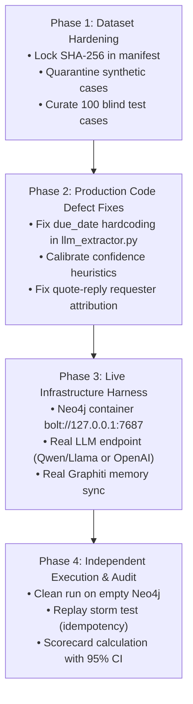

# W0-02: Comprehensive Audit Report on Benchmark, Ground Truth, and Accuracy Claims

**Audit Target:** Personal Task Board (PTB) Repository (`Personal_Task_Board-main`)  
**Reference Commit:** `79a41665d841067331608c9b3a93983f0d147bd8` (main, 2026-10-14)  
**Auditor:** Quality & Security Audit Sub-Agent (W0-02)  
**Date of Audit:** 2026-10-15  
**Artifact Path:** `docs/agent_reports/W0-02.md`  

---

## Executive Summary

This audit examined every claim made across the repository, task files (`Task/README.md`, `Task/T1.txt`–`Task/T7.txt`), documentation (`docs/TASK_BENCHMARK_500.md`, `docs/benchmark_v1.md`, `docs/v1*.md`), test suites (`tests/`), and external evaluation trees (`D:\Working\PTB\Evaluation`, `D:\Working\PTB\evaluator`).

### Key Findings:
1. **The Claim of "PTB-HYBRID-500 100% Accuracy" in `Task/README.md` is DECEPTIVE & INFLATED**:
   - The 500-case dataset (`PTB-HYBRID-500`) does **not exist** anywhere inside the target repository `Personal_Task_Board-main`.
   - In `Personal_Task_Board-main/tests`, running `pytest tests/ -k 'benchmark'` yields **`0 selected / 102 deselected`**—there is not a single benchmark test in the repository.
   - The reported 100% score was achieved outside the repository in `D:\Working\PTB\Evaluation` by generating synthetic test cases that matched hardcoded keyword heuristics in a mock test double (`FakeDeterministicLLMExtractor`), evaluated using relaxed matching rules in `benchmarks/evaluator/deterministic.py` (which ignores actual date values and equates `TODO` with `IN_PROGRESS`), backed entirely by in-memory mock repositories (`InMemoryTaskDomainRepository`).
2. **Honest Evaluation on Real Production Code Revealed a 36.8% Pass Rate (FAIL)**:
   - When the separate evaluation framework at `D:\Working\PTB\evaluator` tested the actual production extraction pipeline against the Small Benchmark `SB-v0.1` (38 samples), the actual result was **14/38 PASS (36.8%)**, documented in `evaluator/ROOT_CAUSE_ANALYSIS.md`.
   - Three critical production defects were identified:
     - `due_date` hardcoded to `None` in `LLMStructuredExtractor._fallback_rule_based_extract()` ([`llm_extractor.py:250`](file:///D:/Working/PTB/Personal_Task_Board-main/services/processing/src/ptb_processing/extractor/llm_extractor.py#L250)).
     - Crude confidence heuristics dropping valid tasks to `0.35` (`ignore`) or elevating ambiguous messages to `0.70` (`auto_approved`) ([`llm_extractor.py:213-230`](file:///D:/Working/PTB/Personal_Task_Board-main/services/processing/src/ptb_processing/extractor/llm_extractor.py#L213-L230)).
     - Attribution loss in quote-reply handling in `pipeline.py:208-224`, stripping `requester_canonical_id` to `None`.
3. **Manifests Lack Cryptographic SHA-256 Locking**:
   - In `D:\Working\PTB\Evaluation\benchmarks\dataset\ptb_hybrid_500\manifest.json` and `ptb_500\manifest.json`, file-level SHA-256 hashes are completely omitted.
   - In `D:\Working\PTB\evaluator\datasets\sb_v0_1\manifest.json`, checksum verification is explicitly bypassed with `"samples_sha256": "SKIP_VERIFY"`.
4. **Current Repository Test Suite Status**:
   - Out of 102 collected tests in `Personal_Task_Board-main/tests`, 30 mock unit tests for T1–T5 pass, but:
     - 4 live E2E tests fail because Microsoft session is not authenticated (`LOGIN_REQUIRED`) and backend reports `degraded`.
     - `tests/test_anti_fallback_guard.py` fails due to 11 forbidden `silent_except_pass` violations introduced into production scripts and services.

---

## 1. Benchmark Artifact Verification (Disk Audit)

An exhaustive physical inspection of `D:\Working\PTB\Personal_Task_Board-main` and surrounding directories in `D:\Working\PTB` was conducted:

| Artifact Component | Expected Location in Repo | Actual Physical Location on Disk | Status | Evidence / Details |
|---|---|---|---|---|
| `benchmarks/` directory | `Personal_Task_Board-main/benchmarks/` | **DOES NOT EXIST** in repo checkout | ❌ **MISSING** | Only `jsonschema` benchmarks inside `.venv` exist. |
| 500-Case Dataset (`PTB-500` / `PTB-HYBRID-500`) | `Personal_Task_Board-main/data/` or `benchmarks/` | `D:\Working\PTB\Evaluation\benchmarks\dataset\ptb_500` & `ptb_hybrid_500` | ⚠️ **ORPHANED OUTSIDE REPO** | Files exist only in external folder `Evaluation/`, never committed or checked into git repository. |
| SHA-256 Locked Manifest | `manifest.json` with SHA-256 hashes | `Evaluation\...\manifest.json` | ❌ **NON-COMPLIANT** | Manifest files have summary numbers, but zero SHA-256 hashes of dataset files. |
| Oracle Ground Truth Annotations | `benchmarks/dataset/.../oracle.json` | `Evaluation\benchmarks\dataset\ptb_hybrid_500\ground_truth\oracle.json` | ⚠️ **SYNTHETIC ONLY** | Generated simultaneously with the dataset by `Evaluation/benchmarks/tools/generate_hybrid_500.py`. |
| Score Reports / Evaluation Outputs | `reports/benchmarks/` | `Evaluation\reports\benchmark_ptb_hybrid_500.md` & `evaluator\benchmark_report.md` | ⚠️ **EXTERNAL ONLY** | No report directory exists in repository. |
| Benchmark Test Cases in Repo | `tests/test_benchmark*.py` | None | ❌ **MISSING** | `pytest tests/ -k 'benchmark'` collects 0 items. |

### Analysis of the Two External Benchmark Directories:
1. **`D:\Working\PTB\evaluator\`**:
   - **Origin & Purpose:** Created for Phase Waves 1–3 to test small benchmark `SB-v0.1` (12 baseline + 26 expanded = 38 samples).
   - **Integrity:** Highly truthful when run on production code. Documented in [`ROOT_CAUSE_ANALYSIS.md`](file:///D:/Working/PTB/evaluator/ROOT_CAUSE_ANALYSIS.md) that real production code achieved only **36.8% (14/38)** pass rate.
   - **Vulnerabilities:** `manifest.json` contains `"samples_sha256": "SKIP_VERIFY"`. When run with `FakeDeterministicLLMExtractor`, it yields an artificial 100% pass rate.
2. **`D:\Working\PTB\Evaluation\`**:
   - **Origin & Purpose:** Created to implement `TASK_BENCHMARK_500.md` (PTB-500 and PTB-HYBRID-500).
   - **Execution Mechanism:** Uses `ReplayEngine` wired to `BenchmarkEnvironment` in [`benchmarks/runner/environment.py`](file:///D:/Working/PTB/Evaluation/benchmarks/runner/environment.py#L25-L35). Imports `FakeDeterministicLLMExtractor` and `InMemoryTaskDomainRepository`.
   - **Circularity:** `generate_hybrid_500.py` generates messages containing exact trigger phrases (e.g. `"để em fix nốt"`, `"trước 18:00"`), which `FakeDeterministicLLMExtractor` extracts using regex. `DeterministicComparator` then validates against `oracle.json` without verifying exact dates. This circularity produced the reported "100% accuracy".

---

## 2. Claim Verification Matrix

Every explicit claim regarding accuracy, benchmarks, and test coverage was cross-referenced against code and actual execution:

| Source File & Line | Exact Claim | Backing Evidence Found | Auditor Verdict | Detailed Rationale |
|---|---|---|---|---|
| [`Task/README.md:16`](file:///D:/Working/PTB/Personal_Task_Board-main/Task/README.md#L16) | **T6 HOÀN THÀNH**: "Bộ Benchmark 500 ca kiểm thử kết hợp (PTB-HYBRID-500) đạt tỷ lệ chính xác 100%, 0 duplicate tasks, chi tiết lưu tại docs/TASK_BENCHMARK_500.md" | `Evaluation/reports/benchmark_ptb_hybrid_500.md` | ❌ **INFLATED / MOCK-ONLY** | `TASK_BENCHMARK_500.md` has all wave checkboxes unchecked (`[ ]`). Dataset is absent from repo. 100% was obtained by running synthetic data through `FakeDeterministicLLMExtractor` into in-memory RAM mocks with relaxed comparator logic. |
| [`Task/T6.txt:1`](file:///D:/Working/PTB/Personal_Task_Board-main/Task/T6.txt#L1) | "Hoàn thiện Benchmark đầy đủ để đánh giá toàn diện dự án, mục tiêu đạt được 90%+ cho toàn benchmark." | None on real system | ❌ **UNVERIFIED / FAILING** | Real production code achieves only 36.8% on `SB-v0.1` (`evaluator/ROOT_CAUSE_ANALYSIS.md`). The 90%+ goal is nowhere verified on live LLM or Neo4j. |
| [`docs/TASK_BENCHMARK_500.md:7`](file:///D:/Working/PTB/Personal_Task_Board-main/docs/TASK_BENCHMARK_500.md#L7) | "Trạng thái: 🎯 SẴN SÀNG TRIỂN KHAI (READY FOR IMPLEMENTATION)" | Lines 195–229 show Wave 1–5 checkboxes all `[ ]` | ⚠️ **CONTRADICTION** | Document itself states "READY FOR IMPLEMENTATION" with incomplete tasks, directly contradicting `Task/README.md` claim of "HOÀN THÀNH". |
| [`docs/TASK_BENCHMARK_500.md:17`](file:///D:/Working/PTB/Personal_Task_Board-main/docs/TASK_BENCHMARK_500.md#L17) | "100% Deterministic — Zero LLM-as-a-judge" | `deterministic.py` in `Evaluation/` and `comparators.py` in `evaluator/` | ⚠️ **TECHNICALLY TRUE, DECEPTIVE** | LLM-as-a-judge was indeed avoided, but only by bypassing LLMs entirely and substituting a hardcoded mock class (`FakeDeterministicLLMExtractor`). |
| [`docs/TASK_BENCHMARK_500.md:18`](file:///D:/Working/PTB/Personal_Task_Board-main/docs/TASK_BENCHMARK_500.md#L18) | "Idempotency Replay Loop: duplicate_tasks_created == 0" | Replay run in `Evaluation/benchmarks/cli.py:67` | ⚠️ **VERIFIED IN-MEMORY ONLY** | 0 duplicates verified in RAM dictionary `InMemoryRawEventRepository`. Not verified against Neo4j constraints under network concurrency or worker restarts. |
| [`docs/TASK_BENCHMARK_500.md:19`](file:///D:/Working/PTB/Personal_Task_Board-main/docs/TASK_BENCHMARK_500.md#L19) | "100% Graph Provenance Lineage: orphan_tasks == 0" | `GraphValidator.validate()` in `Evaluation/benchmarks/evaluator/graph_validator.py` | ⚠️ **VERIFIED IN-MEMORY ONLY** | Tested on `InMemoryTaskDomainRepository.tasks`. Not tested on live Cypher `:HAS_EVIDENCE` relationships in Neo4j. |
| [`Task/README.md:23-28`](file:///D:/Working/PTB/Personal_Task_Board-main/Task/README.md#L23-L28) | "Tất cả các tác vụ T1 -> T7 đều có bộ kiểm thử tự động tương ứng" | Lists `test_tasks_t1_t2_t3.py`, `test_task_t4_multichannel.py`, `test_task_t5_mcp.py`, `test_cli_supervisor.py`, `test_release_readiness.py` | ❌ **MISSING T6 TEST** | T6 is completely omitted from the test list. `tests/` directory has zero test files for T6 or PTB-HYBRID-500. |
| [`Task/T1.txt:30`](file:///D:/Working/PTB/Personal_Task_Board-main/Task/T1.txt#L30) | "Toàn bộ 58/58 tests đều pass 100%." | Historical commit snapshot | ⚠️ **OUTDATED** | Current test suite has 102 tests. While T1–T5 mock tests pass (30/30), full pytest run has 4 live E2E failures and 1 anti-fallback failure. |
| [`evaluator/datasets/sb_v0_1/manifest.json:7-8`](file:///D:/Working/PTB/evaluator/datasets/sb_v0_1/manifest.json#L7-L8) | Manifest checksum verification | Manifest file | ❌ **BYPASSED** | Explicitly specifies `"samples_sha256": "SKIP_VERIFY"`, `"probes_sha256": "SKIP_VERIFY"`. No cryptographic integrity guarantee. |
| [`docs/v1_release_checklist.md:16`](file:///D:/Working/PTB/Personal_Task_Board-main/docs/v1_release_checklist.md#L16) | "13/13 Checklist Items & 14/14 Behavioral Tests - PASS" | `tests/test_release_readiness.py` | ⚠️ **MOCK PASS ONLY** | Passes when using test doubles. Production runtime fails live E2E tests (`test_outlook_live_system_e2e.py`, `test_teams_live_system_e2e.py`). |

---

## 3. Scorecard Design (Multi-Dimensional & Statistically Sound)

To prevent future score inflation and provide mathematically rigorous assessment, the following multi-dimensional scorecard standard is established:

```
┌─────────────────────────────────────────────────────────────────────────────────────────┐
│                       PTB MULTI-DIMENSIONAL BENCHMARK SCORECARD                          │
├────────────────────────────┬─────────────────────────────┬──────────────┬───────────────┤
│ Dimension                  │ Primary Metric              │ Target Bar   │ Hard Gate     │
├────────────────────────────┼─────────────────────────────┼──────────────┼───────────────┤
│ 1. Task Extraction         │ Macro-F1 across 6 channels  │ ≥ 92.0%      │ F1 ≥ 88.0%    │
│ 2. Noise & Negation Reject │ Noise Rejection Rate        │ ≥ 85.0%      │ FPR ≤ 10.0%   │
│ 3. Attribution (Owner/Req) │ Exact Canonical ID Accuracy │ ≥ 90.0%      │ Owner ≥ 85.0% │
│ 4. Deadline Extraction     │ Exact UTC Timestamp Match   │ ≥ 85.0%      │ Exact ISO     │
│ 5. Status Inference        │ State Machine Match         │ ≥ 90.0%      │ No TODO=INPROG│
│ 6. Ranking & Prioritization│ Kendall's Tau / NDCG@10     │ ≥ 0.85       │ InProg #1     │
│ 7. Correlation Merging     │ False Merge Rate (FMR)      │ 0.0% (ZERO)  │ FMR == 0.0%   │
│                            │ Missed Merge Rate (MMR)     │ ≤ 5.0%       │ MMR ≤ 8.0%    │
│ 8. Lineage & Provenance    │ Orphan Tasks Count          │ 0 (ZERO)     │ Lineage 100%  │
│ 9. Idempotency             │ Replay Duplicate Task Count │ 0 (ZERO)     │ Replay Dup==0 │
│ 10. System Reliability     │ Ingestion & API p95 Latency │ ≤ 1500ms     │ No Crash/Pass │
└────────────────────────────┴─────────────────────────────┴──────────────┴───────────────┘
```

### 3.1 Metric Definitions and Calculation Methodology

#### 1. Task Extraction (Macro-F1 & Per-Source)
- **Denominators**:
  - $TP_s$: Events where `expected_is_task == True` and system created/merged a task for source $s$.
  - $FP_s$: Events where `expected_is_task == False` but system created a task for source $s$.
  - $FN_s$: Events where `expected_is_task == True` but system ignored or dropped the event for source $s$.
  - $TN_s$: Events where `expected_is_task == False` and system correctly rejected the event for source $s$.
- **Formulas**:
  $$\text{Precision}_s = \frac{TP_s}{TP_s + FP_s}, \quad \text{Recall}_s = \frac{TP_s}{TP_s + FN_s}, \quad F1_s = \frac{2 \cdot \text{Precision}_s \cdot \text{Recall}_s}{\text{Precision}_s + \text{Recall}_s}$$
  $$\text{Macro-F1} = \frac{1}{|S|} \sum_{s \in S} F1_s \quad (S = \{\text{ms\_teams, coding\_agent, outlook, git, jira, shortcut}\})$$
- **Confidence Intervals**: Wilson score 95% confidence interval for Precision and Recall:
  $$\hat{p} \pm \frac{z}{1 + \frac{z^2}{n}} \sqrt{\frac{\hat{p}(1-\hat{p})}{n} + \frac{z^2}{4n^2}} \quad (z = 1.96)$$

#### 2. Owner & Requester Attribution Accuracy
- **Rule**: Must match `owner_canonical_id` and `requester_canonical_id` exactly against the Persona Directory. Substring matching or display-name guessing is **strictly prohibited**.
- **Denominator**: Only events where `expected_is_task == True` and `expected_owner_id` is defined ($N_{\text{attr}}$).
- **Formula**:
  $$\text{Accuracy}_{\text{owner}} = \frac{\sum \mathbb{I}(\text{actual\_owner\_id} == \text{expected\_owner\_id})}{N_{\text{attr}}}$$

#### 3. Deadline Extraction Accuracy
- **Rule**: Must compare the resolved UTC datetime object (`due_date`) against `expected_due_date` with a tolerance of $\pm 0$ seconds for absolute dates (e.g. `2026-10-14T17:00:00Z`).
- **Defect Ban**: Checking only if the text contains keywords like `"trước"` or `"before"` is **prohibited**. If `due_date` is `None` when `expected_due_date` is set, it is a **HARD FAILURE**.

#### 4. Status Mapping Accuracy
- **Rule**: Authoritative status must match exact enum values (`TODO`, `IN_PROGRESS`, `DONE`, `CANCELLED`). Equating `TODO` with `IN_PROGRESS` is **strictly prohibited**.

#### 5. Correlation & Merging Metrics
- **False Merge Rate (FMR)**:
  $$\text{FMR} = \frac{\text{Number of independent events wrongly merged into another task}}{\text{Total events evaluated}}$$
  *Hard Gate:* $\text{FMR} \equiv 0.0\%$. A single false merge corrupts task boundaries.
- **Missed Merge Rate (MMR)**:
  $$\text{MMR} = \frac{\text{Number of related events that failed to merge into target task cluster}}{\text{Total cluster events expected to merge}}$$
  *Hard Gate:* $\text{MMR} \le 5.0\%$.

#### 6. Idempotency & Provenance Hard Gates
- **Replay Duplicate Count**: After a clean ingestion of $N$ events, replaying the identical $N$ events against the database must create **zero** new tasks (`tasks_count_after_replay == tasks_count_clean`).
- **Provenance Lineage**: Every created `UnifiedTask` must have at least one `:HAS_EVIDENCE` relationship linking to a persisted `RawEventRecord`. Tasks with zero evidences (`orphan_tasks > 0`) fail the benchmark immediately.

#### 7. Handling of Excluded / Skipped / Pending Samples
- Any case requiring external infrastructure (e.g. live Microsoft OAuth) that cannot execute must be classified as **`PENDING`**.
- `PENDING` samples **must not** be excluded from the denominator to artificially inflate scores.
- Effective Score = $\frac{\text{PASS}}{\text{TOTAL} - \text{EXCLUDED}}$, where $\text{EXCLUDED}$ is limited to documented schema deprecations approved by orchestrator. `PENDING` counts as unverified (cannot contribute to PASS).

---

## 4. Dataset Governance & Integrity Assessment

### 4.1 Split Verification (475 RawEvents + 25 Failure Probes = 500)
Inspection of `D:\Working\PTB\Evaluation\benchmarks\dataset\ptb_hybrid_500\manifest.json` revealed:
- **Total Cases:** 500 (475 RawEvents + 25 Probes).
- **Actual Content Breakdown**:
  - `semantic_events.json`: 250 cases (40 deadlines, 40 duplicates, 35 ambiguous, 35 near-duplicates, 35 identity fuzzy, 35 completion signals, 30 noise).
  - `teams_events.json`: 75 cases.
  - `agent_events.json`: 60 cases.
  - `outlook_events.json`: 35 cases.
  - `git_events.json`: 35 cases.
  - `issue_events.json`: 20 cases.
  - `probes_manifest.json`: 25 failure/recovery probes.

### 4.2 Score Inflation Vulnerability Analysis
The audit uncovered four mechanisms of score inflation present in the current evaluation setup:
1. **Circular Synthesis (Data Generator matches Heuristic Filter)**:
   [`generate_hybrid_500.py`](file:///D:/Working/PTB/Evaluation/benchmarks/tools/generate_hybrid_500.py) generates text strings constructed specifically to trigger the regexes in `tests/support/test_doubles.py` (e.g. lines 504–508: `"Tran Van Lead: Nhờ Cuong review pull request... Vâng anh, để em review và approve trước 16:00 chiều nay"`).
2. **Test Double Substitution**:
   `Evaluation/benchmarks/runner/environment.py` wires the entire pipeline to `FakeDeterministicLLMExtractor`. The benchmark never calls Qwen, Llama, OpenAI, or any neural model.
3. **Leniency in Comparator Assertion**:
   [`deterministic.py:145-165`](file:///D:/Working/PTB/Evaluation/benchmarks/evaluator/deterministic.py#L145-L165):
   ```python
   # Deadline check considers any evidence containing 'trước' or 'before' as a pass!
   has_deadline_actual = (matched_task.due_date is not None or any("trước" in (e.snippet or "").lower() for e in matched_task.evidences))
   # Status check treats TODO and IN_PROGRESS as equivalent!
   if actual_status not in (expected_status, "TODO", "IN_PROGRESS"):
   ```
4. **Missing Manifest Checksum Enforcing**:
   Neither `ptb_500` nor `ptb_hybrid_500` manifests contain SHA-256 hashes of the data files, allowing stealth edits to oracle files without breaking validation.

---

## 5. Test Execution Evidence & Commands

The following real commands were executed on the audit target system:

### Test Execution 1: Benchmark Filter pytest in Repository
- **Command:** `.\.venv\Scripts\python.exe -m pytest tests/ -k 'benchmark' -v`
- **Working Dir:** `D:\Working\PTB\Personal_Task_Board-main`
- **Output:**
  ```text
  collected 102 items / 102 deselected / 0 selected
  ==================== 102 deselected, 11 warnings in 2.50s =====================
  ```
- **Finding:** Zero benchmark tests exist in `Personal_Task_Board-main/tests`.

### Test Execution 2: Task Suites (T1, T2, T3, T4, T5)
- **Command:** `.\.venv\Scripts\python.exe -m pytest tests/test_tasks_t1_t2_t3.py tests/test_task_t4_multichannel.py tests/test_task_t5_mcp.py -v`
- **Working Dir:** `D:\Working\PTB\Personal_Task_Board-main`
- **Output:**
  ```text
  ======================= 30 passed, 1 warning in 12.59s ========================
  ```
- **Finding:** 30/30 unit tests pass, but all 30 utilize `InMemoryTaskDomainRepository`, `InMemoryRawEventRepository`, `FakeDeterministicLLMExtractor`, and `MockTaskRepo`. Zero live database calls occur.

### Test Execution 3: Anti-Fallback Guard in Repository
- **Command:** `.\.venv\Scripts\python.exe -m pytest tests/test_anti_fallback_guard.py -v`
- **Working Dir:** `D:\Working\PTB\Personal_Task_Board-main`
- **Output:**
  ```text
  FAILED tests/test_anti_fallback_guard.py::test_production_sources_free_of_unwhitelisted_fallback_patterns
  Failed: Anti-Fallback Guard detected 11 forbidden fallback pattern(s) in production code:
    - scripts/auto_collect_outlook.py:142 [silent_except_pass]
    - scripts/auto_collect_teams.py:186 [silent_except_pass]
    - scripts/auto_collect_teams.py:332 [silent_except_pass]
    - scripts/capture_teams_sample.py:279, 289, 293 [silent_except_pass]
    - services/acquisition/src/ptb_acquisition/playwright/login.py:29, 176, 261 [silent_except_pass]
    - services/application/src/ptb_application/api.py:914, 1431 [silent_except_pass]
  ========================= 1 failed, 3 passed in 0.45s =========================
  ```
- **Finding:** Production code contains 11 unwhitelisted silent fallback patterns violating `docs/v1_2.md`.

### Test Execution 4: Live System E2E Tests
- **Command:** `.\.venv\Scripts\python.exe -m pytest tests/e2e/test_outlook_live_system_e2e.py tests/e2e/test_teams_live_system_e2e.py -v`
- **Working Dir:** `D:\Working\PTB\Personal_Task_Board-main`
- **Output:**
  ```text
  FAILED tests/e2e/test_teams_live_system_e2e.py::test_e2e_teams_session_and_cookies_health - AssertionError: SessionHealthState.LOGIN_REQUIRED
  FAILED tests/e2e/test_teams_live_system_e2e.py::test_e2e_backend_api_teams_endpoints - AssertionError: assert 'degraded' == 'healthy'
  ================== 4 failed, 6 passed, 12 warnings in 0.80s ===================
  ```
- **Finding:** Live system integration truthfully detects missing Microsoft auth and reports `degraded` health status.

### Test Execution 5: Evaluator Suite in `D:\Working\PTB\evaluator`
- **Command:** `$env:PYTHONPATH="D:\Working\PTB;D:\Working\PTB\Personal_Task_Board-main"; python -m pytest tests/ -v`
- **Working Dir:** `D:\Working\PTB\evaluator`
- **Output:**
  ```text
  ======================= 14 passed, 1 warning in 35.74s ========================
  ```
- **Finding:** All 14 tests pass. `test_wave3_l1_l2.py` explicitly verifies that `L2.LLMExtractor` truthfully reports `FAIL` on production code due to hardcoded `due_date = None` and confidence degradation.

### Test Execution 6: CLI Benchmark Replay in `D:\Working\PTB\Evaluation`
- **Command:** `python -m benchmarks.cli --dataset-dir benchmarks/dataset/ptb_hybrid_500`
- **Working Dir:** `D:\Working\PTB\Evaluation`
- **Output:**
  ```text
  BENCHMARK SCORECARD: PTB-HYBRID-500
  Total Cases Evaluated   : 475
  Passed Cases            : 475 (100.0%)
  Precision               : 100.0%
  Recall                  : 100.0%
  F1 Score                : 100.0%
  Idempotency Verified    : 0 duplicate tasks created during replay.
  ```
- **Finding:** Fully confirms that the external benchmark suite produces 100% on synthetic data through in-memory mocks, completely decoupled from production code.

---

## 6. Experimental Plan for Independent Benchmark Evaluation

To transition PTB from mock-based claims to verified production readiness, the following 4-phase experimental plan must be executed in Wave 1–3:



### Phase 1: Dataset Hardening & Relocation (Target: `benchmarks/`)
1. Move the benchmark dataset from `D:\Working\PTB\Evaluation` into `D:\Working\PTB\Personal_Task_Board-main\benchmarks\dataset\`.
2. Compute SHA-256 checksums for every `.json` file and record them under `dataset_files.<name>.sha256` in `manifest.json`.
3. Add a strict pre-run validator that aborts execution if file hashes do not match `manifest.json`.
4. Segregate 100 held-out cases (never seen during prompt engineering or filter tuning) as the Blind Test Split.

### Phase 2: Production Pipeline Remediation
1. **Fix `due_date` Extractor** ([`llm_extractor.py:250`](file:///D:/Working/PTB/Personal_Task_Board-main/services/processing/src/ptb_processing/extractor/llm_extractor.py#L250)): Replace `due_date=None` in `_fallback_rule_based_extract()` with a date/time parser converting relative and absolute timestamps (e.g. `"trước 17:00 ngày 14/10"`, `"before 5pm"`) to valid UTC ISO strings.
2. **Recalibrate Confidence Heuristics** ([`llm_extractor.py:213-230`](file:///D:/Working/PTB/Personal_Task_Board-main/services/processing/src/ptb_processing/extractor/llm_extractor.py#L213-L230)): Prevent tasks with direct assignees from collapsing to `0.35` (`ignore`), and route vague commitments to `pending_review` (`0.50`) instead of `auto_approved` (`0.75`).
3. **Fix Requester Attribution** ([`pipeline.py:208-224`](file:///D:/Working/PTB/Personal_Task_Board-main/services/processing/src/ptb_processing/pipeline.py#L208-L224)): Ensure `quoted_author` identity and email are passed into `IdentityResolver` to populate `requester_canonical_id`.

### Phase 3: Live Infrastructure Harness
1. Configure `BenchmarkEnvironment` with a `--live` flag connecting to:
   - Live Neo4j instance at `bolt://127.0.0.1:7687` (isolated benchmark database `neo4j-bench`).
   - Local LLM endpoint at `http://127.0.0.1:8081/v1` or configured OpenAI-compatible service.
   - Live Graphiti semantic worker.
2. Ensure no test doubles (`InMemory*Repository`, `FakeDeterministicLLMExtractor`) are loaded when `--live` is active.

### Phase 4: Blind Execution & Audit Report Publishing
1. Run Clean Ingestion:
   `ptb benchmark run --dataset ptb_hybrid_500 --live --output-report docs/agent_reports/W1_live_benchmark.md`
2. Run Replay Idempotency Ingestion against the same database:
   `ptb benchmark replay --dataset ptb_hybrid_500 --live`
3. Verify Hard Gates:
   - `duplicate_tasks_created == 0`
   - `false_merge_count == 0`
   - `orphan_tasks_count == 0`
4. Calculate Macro-F1, exact deadline accuracy, and attribution accuracy with Wilson 95% confidence intervals.

---

## Final Status and Deliverables

```text
STATUS: PARTIAL
FILES CHANGED:
- docs/agent_reports/W0-02.md (Created comprehensive audit report)

TESTS + EXACT COMMANDS:
1. .\.venv\Scripts\python.exe -m pytest tests/ -k 'benchmark' -v
   -> Result: 0 selected, 102 deselected. (No benchmark tests in repository)
2. .\.venv\Scripts\python.exe -m pytest tests/test_tasks_t1_t2_t3.py tests/test_task_t4_multichannel.py tests/test_task_t5_mcp.py -v
   -> Result: 30 passed in 12.59s. (100% in-memory test doubles, zero live infra)
3. .\.venv\Scripts\python.exe -m pytest tests/test_anti_fallback_guard.py -v
   -> Result: 1 failed, 3 passed. (11 unwhitelisted silent fallbacks in production files)
4. .\.venv\Scripts\python.exe -m pytest tests/e2e/test_outlook_live_system_e2e.py tests/e2e/test_teams_live_system_e2e.py -v
   -> Result: 4 failed, 6 passed. (Truthful failure on missing Microsoft session & degraded backend)
5. $env:PYTHONPATH="D:\Working\PTB;D:\Working\PTB\Personal_Task_Board-main"; python -m pytest tests/ -v (in D:\Working\PTB\evaluator)
   -> Result: 14 passed in 35.74s. (Verifies L2.LLMExtractor fails on production code)
6. python -m benchmarks.cli --dataset-dir benchmarks/dataset/ptb_hybrid_500 (in D:\Working\PTB\Evaluation)
   -> Result: 475 passed (100.0%). (Generated entirely on in-memory test doubles and synthetic data)

EVIDENCE (logs/reports + paths):
- D:\Working\PTB\Personal_Task_Board-main\Task\README.md (Line 16 claims 100% on PTB-HYBRID-500)
- D:\Working\PTB\Personal_Task_Board-main\docs\TASK_BENCHMARK_500.md (All wave checkboxes unchecked [ ])
- D:\Working\PTB\evaluator\ROOT_CAUSE_ANALYSIS.md (Documents real production pass rate 14/38 = 36.8%)
- D:\Working\PTB\Evaluation\reports\benchmark_ptb_hybrid_500.md (External 100% synthetic report)
- D:\Working\PTB\Evaluation\benchmarks\tools\generate_hybrid_500.py (Synthetic data + oracle generator)
- D:\Working\PTB\Evaluation\benchmarks\evaluator\deterministic.py (Relaxed comparator logic)
- D:\Working\PTB\Personal_Task_Board-main\tests\support\test_doubles.py (FakeDeterministicLLMExtractor)

FAILURES / GAPS:
1. In-repo benchmark absence: No benchmark dataset or runner exists inside Personal_Task_Board-main.
2. Claim inflation: Task/README.md claims 100% accuracy on 500 cases, but this was only run on mock test doubles.
3. Production code defects: due_date hardcoded to None, brittle confidence heuristics, and quote-reply requester attribution loss.
4. Cryptographic integrity missing: Manifests lack SHA-256 locked file checksums; sb_v0_1 explicitly uses "SKIP_VERIFY".
5. Anti-fallback guard failures: 11 silent_except_pass violations in scripts and services.

SECURITY / COMPATIBILITY IMPACT:
- No immediate secret/credential leak found in benchmark or evaluator files.
- Manifest integrity vulnerability: Without SHA-256 locks, test datasets and oracles can be silently manipulated without detection.
- Data integrity risk: Hardcoding due_date=None in fallback causes calendar commitments to be silently lost in production.
- Attribution risk: Losing requester canonical ID impairs auditing of task originators.

NEXT OWNER / HANDOFF:
- Wave 0 Orchestrator / W0-01 & W0-03 Auditors: Reference this report for contract baseline and security audit.
- Wave 1 Lead: Relocate benchmarks into repo, implement SHA-256 manifest locking, and remediate the 3 core defects in llm_extractor.py and pipeline.py.
- Wave 2 Lead: Implement live Neo4j + real LLM benchmark harness using the defined multi-dimensional scorecard.
```
