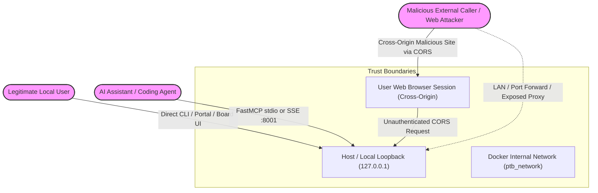

# W0-03: Security & Deployment Readiness Audit Report

**Audit Target:** Personal Task Board (PTB)  
**Repository:** [https://github.com/nxc1802/Personal_Task_Board](https://github.com/nxc1802/Personal_Task_Board)  
**Reference Commit:** `79a41665d841067331608c9b3a93983f0d147bd8` (main, 2026-10-14)  
**Auditor:** Senior Software & Security Quality Auditor (Sub-Agent W0-03)  
**Audit Date:** 2026-10-15  
**Execution Environment:** Windows 11 Host, Python 3.12.9 venv, Docker Desktop Engine 27.x  

---

## Executive Summary

An exhaustive security, isolation, and deployment readiness audit of the Personal Task Board codebase was conducted against live services, configuration files, containers, and source code.

While PTB provides solid architectural foundations for personal single-user productivity with local graph persistence via Neo4j and FastMCP tool interfaces, **the codebase currently exhibits severe security deficiencies that strictly block production deployment**:
1. **Critical CORS Wildcard Vulnerability (P0):** [`create_app`](file:///D:/Working/PTB/Personal_Task_Board-main/services/application/src/ptb_application/api.py#L185-L198) combines `allow_origin_regex=r".*"` with `allow_credentials=True`. Any third-party website visited by a user can execute credentialed cross-origin read/write queries against `http://127.0.0.1:8000`, exfiltrating private corporate tasks, Microsoft Teams chats, Outlook email snippets, and deep links.
2. **Zero Authentication on API & WebUI (P0):** Neither the FastAPI backend nor OpenWebUI enforce authentication. In [`docker-compose.prod.yml`](file:///D:/Working/PTB/Personal_Task_Board-main/docker-compose.prod.yml#L87), `WEBUI_AUTH=False` is explicitly set. All 20 API endpoints have zero auth middleware or role enforcement.
3. **Secret Leaks via Docker Build & Source Code (P0/P1):** [`.dockerignore`](file:///D:/Working/PTB/Personal_Task_Board-main/.dockerignore#L1-L21) omits `.env`. Running `docker build` copies local `.env` containing live API keys and Neo4j passwords directly into container image layers. Furthermore, a private API key mock pattern prefix was hardcoded in [`server.py`](file:///D:/Working/PTB/Personal_Task_Board-main/services/mcp/src/ptb_mcp/server.py#L297).
4. **Complete Absence of Multi-Tenant / User Data Isolation (P1):** Neo4j queries in [`task_repo.py`](file:///D:/Working/PTB/Personal_Task_Board-main/packages/database/src/ptb_database/repositories/task_repo.py) completely lack `tenant_id` and `user_id` scoping; [`get_active_commitments`](file:///D:/Working/PTB/Personal_Task_Board-main/packages/database/src/ptb_database/repositories/task_repo.py#L1010-L1037) accepts `user_id` but ignores it entirely in Cypher.

Overall deployment readiness is rated **NOT PRODUCTION READY**.

---

## 1. Threat Model & Actor Matrix

### 1.1 Threat Actors



1. **Actor 1: Legitimate Local User**
   - **Context:** Developer or operator running PTB locally or accessing OpenWebUI / Dev Portal.
   - **Trust Level:** High (Owner).
   - **Intent:** Task tracking, workflow automation, knowledge retrieval.
   - **Risks to Mitigate:** Accidental data corruption via destructive operations (`/api/database/reset`), credential leakage during interactive sessions.
2. **Actor 2: AI Assistant / Coding Agent**
   - **Context:** Cursor IDE, Claude Desktop, Antigravity, or Cline communicating via stdio or FastMCP SSE on port 8001.
   - **Trust Level:** Semi-trusted. Agents have autonomy to create, update, or analyze code, but can suffer from hallucinations, prompt injection, or rogue actions.
   - **Intent:** Automated task lifecycle updates, reading today's plan, recording architectural decisions and lessons learned.
   - **Risks to Mitigate:** Unchecked task deletion, privilege escalation, unverified approval/dismissal of review items, exfiltration of graph memory.
3. **Actor 3: Malicious External Caller / Web Attacker**
   - **Context:** Untrusted remote actor accessing the machine via:
     - Cross-origin malicious websites visited by the user (exploiting permissive CORS).
     - Local network / LAN exposure if ports are bound to `0.0.0.0` or reverse-proxied.
     - Malicious prompts delivered via ingested channels (Teams, Outlook, Git commits, Jira) attempting Indirect Prompt Injection.
   - **Trust Level:** Untrusted (Adversarial).
   - **Intent:** Exfiltrate confidential emails/chats, delete task board data, pivot to host execution via Playwright automation, poison cookie store.

---

### 1.2 Permission Matrix: Proposed vs Current Reality

| Resource / Operation | Operation Type | Legitimate User | AI Coding Agent (MCP) | External Caller | Current Enforcement Status |
|---|---|:---:|:---:|:---:|---|
| **View Today Plan / Tasks** (`/api/today`, `/api/tasks`) | Read | Allow | Allow (Read-Only) | Deny | ❌ **FAILED**: Anyone/any origin can read |
| **Search Knowledge / Decisions** (`/api/knowledge`) | Read | Allow | Allow | Deny | ❌ **FAILED**: Unauthenticated |
| **Check Health** (`/health`, `/api/sources/health`) | Read | Allow | Allow | Allow (safe subset) | ⚠️ **PARTIAL**: Exposes internal tenant status |
| **Create / Patch Task** (`/api/tasks`, `/api/tasks/{id}`) | Write | Allow | Allow (with Actor tag) | Deny | ❌ **FAILED**: No identity verification |
| **Update Task Status** (`/api/tasks/{id}/status`) | Write | Allow | Allow (Canonical FSM) | Deny | ❌ **FAILED**: Any client can change status |
| **Ingest Message / Sweep** (`/api/ingest/*`) | Write | Allow | Allow | Deny | ❌ **FAILED**: Unauthenticated trigger |
| **Record Decision / Lesson** (MCP tools 18, 19) | Write | Allow | Allow | Deny | ⚠️ **PARTIAL**: Only in MCP 19-tool mode |
| **Approve / Dismiss Review** (`/api/review/*`) | Write/Mod | Allow | Require Confirmation | Deny | ❌ **FAILED**: Agents/external can approve freely |
| **Delete / Dismiss Task** (`/api/tasks/{id}`, `delete_task`) | Destructive | Allow | Deny or Soft-delete | Deny | ❌ **FAILED**: MCP and REST allow deletion with no auth |
| **Save / Import Cookies** (`/api/auth/save-cookie`) | Critical Write | Allow (Local only) | Deny | Deny | ❌ **FAILED**: Unauthenticated endpoint overwrites host cookies |
| **Spawn Login Browser** (`/api/auth/start-login`) | Host Exec | Allow (Local only) | Deny | Deny | ❌ **FAILED**: Unauthenticated endpoint launches host PowerShell |
| **Database Reset** (`/api/database/reset`) | Destructive | Allow (Local CLI only) | Deny | Deny | ⚠️ **PARTIAL**: Blocked by env flag, but unauthenticated if enabled |

---

## 2. Issue Ledger (P0 / P1 / P2)

### P0 — Critical Vulnerabilities (Blocks Production & Deployment)

#### [P0-1] Arbitrary Origin Reflection with Credentials in API CORS Middleware
- **Evidence:** [`services/application/src/ptb_application/api.py#L185-L198`](file:///D:/Working/PTB/Personal_Task_Board-main/services/application/src/ptb_application/api.py#L185-L198)
  ```python
  app.add_middleware(
      CORSMiddleware,
      allow_origins=[...],
      allow_origin_regex=r".*",
      allow_credentials=True,
      allow_methods=["*"],
      allow_headers=["*"],
  )
  ```
- **Live Empirical Verification:**
  ```bash
  curl -i -s -X OPTIONS http://127.0.0.1:8000/api/tasks \
       -H "Origin: https://evil-attacker.example.com" \
       -H "Access-Control-Request-Method: GET"
  ```
  **Live Response Headers:**
  ```http
  HTTP/1.1 200 OK
  access-control-allow-credentials: true
  access-control-allow-origin: https://evil-attacker.example.com
  access-control-allow-methods: DELETE, GET, HEAD, OPTIONS, PATCH, POST, PUT, QUERY
  ```
  Executing `curl -s http://127.0.0.1:8000/api/today -H "Origin: https://evil-attacker.example.com"` returned the entire board dataset including employee names, customer payment recovery items, and Microsoft Teams deep links.
- **Exploitation Impact:** When a developer visits any external webpage while PTB runs on `127.0.0.1:8000`, the attacker's JavaScript can make authenticated XMLHttpRequests/fetch calls to read internal company tasks, messages, and execute mutations.
- **Remediation:**
  1. Remove `allow_origin_regex=r".*"`.
  2. Set explicit allowed origins strictly to `["http://127.0.0.1:3000", "http://localhost:3000"]` (or configure via `PTB_ALLOWED_ORIGINS`).
  3. When `allow_credentials=True`, never use wildcards or unanchored regex.

---

#### [P0-2] Complete Absence of Authentication & Authorization Middleware in REST API
- **Evidence:** [`services/application/src/ptb_application/api.py#L168-L1663`](file:///D:/Working/PTB/Personal_Task_Board-main/services/application/src/ptb_application/api.py#L168-L1663)
- **Finding:** There is zero security middleware (no API Key header, no OAuth2/JWT bearer token, no session cookie validation). Every endpoint (`/api/today`, `/api/tasks`, `/api/review`, `/api/ingest/*`, `/api/auth/*`) is accessible to any anonymous HTTP client.
- **Remediation:**
  1. Implement FastAPI `Security(HTTPBearer())` or `APIKeyHeader(name="X-PTB-API-KEY")` dependency.
  2. Verify tokens against a configured secret (`PTB_API_KEY` or JWT secret).
  3. Expose only `/health` as an unauthenticated endpoint.

---

#### [P0-3] `WEBUI_AUTH=False` Configured in Production Docker Compose
- **Evidence:** [`docker-compose.prod.yml#L87`](file:///D:/Working/PTB/Personal_Task_Board-main/docker-compose.prod.yml#L87) and [`docker-compose.yml#L36`](file:///D:/Working/PTB/Personal_Task_Board-main/docker-compose.yml#L36)
  ```yaml
  open-webui:
    image: ghcr.io/open-webui/open-webui:v0.5.10
    environment:
      - WEBUI_AUTH=False
  ```
- **Live Empirical Verification:**
  `curl -s http://127.0.0.1:3000/api/config` returned:
  ```json
  {"status":true,"features":{"auth":false,"enable_api_key":true,"enable_signup":false}}
  ```
- **Exploitation Impact:** Anyone reaching port 3000 bypasses all login prompts, immediately accessing the administrative account with ability to chat with LLM models, view chat histories, trigger PTB tool actions, and consume cloud LLM credits.
- **Remediation:**
  1. In `docker-compose.prod.yml`, change `WEBUI_AUTH` to `True`.
  2. Configure admin bootstrap credentials via `WEBUI_ADMIN_EMAIL` and `WEBUI_ADMIN_PASSWORD` (or enforce first-run sign-up).

---

#### [P0-4] `.env` File Excluded from `.dockerignore` — Secrets Layer Leakage
- **Evidence:** [`.dockerignore#L1-L21`](file:///D:/Working/PTB/Personal_Task_Board-main/.dockerignore#L1-L21) vs [`Dockerfile#L52`](file:///D:/Working/PTB/Personal_Task_Board-main/Dockerfile#L52)
  ```dockerfile
  # Dockerfile line 52:
  COPY --chown=ptbuser:ptbuser . /app
  ```
- **Finding:** While `.gitignore` correctly ignores `.env`, `.dockerignore` contains `.git`, `.venv`, `*.log`, `data/`, but **omits `.env`**.
- **Exploitation Impact:** When `docker build` or `docker compose build` runs on any workstation containing a `.env` file, the `.env` file containing live `NEO4J_PASSWORD`, `LLM_API_KEY`, and `OPENAI_API_KEY` is baked into the immutable image layer. Pushing the image to a container registry permanently exposes these credentials.
- **Remediation:**
  Add `.env` and `.env*.local` to `.dockerignore`.

---

#### [P0-5] Unauthenticated Destructive Reset Endpoint (`/api/database/reset`)
- **Evidence:** [`services/application/src/ptb_application/api.py#L1480-L1502`](file:///D:/Working/PTB/Personal_Task_Board-main/services/application/src/ptb_application/api.py#L1480-L1502)
  ```python
  @app.post("/api/database/reset")
  async def reset_database_api(service: ApplicationService = Depends(...)):
      if os.getenv("PTB_ENABLE_DESTRUCTIVE_API", "false").lower() not in ("true", "1"):
          raise HTTPException(status_code=403, detail="...")
      await client.execute_write("MATCH (n) DETACH DELETE n")
  ```
- **Finding:** The endpoint checks an environment variable (`PTB_ENABLE_DESTRUCTIVE_API`), but does not verify caller identity. If a developer sets `PTB_ENABLE_DESTRUCTIVE_API=true` in `.env` for testing, any web page via CORS or any local process can wipe the entire Neo4j database with a simple unauthenticated HTTP POST.
- **Remediation:**
  1. Remove this endpoint from the HTTP REST API entirely; destructive database operations should only be executed via CLI (`ptb db reset --force`).
  2. If retained in debug mode, require an explicit admin master key header.

---

### P1 — High Severity Issues (Data Isolation, Agent Governance & Integrity)

#### [P1-1] Zero Multi-Tenant and User Data Scoping in Neo4j Queries
- **Evidence:**
  - [`packages/database/src/ptb_database/repositories/task_repo.py`](file:///D:/Working/PTB/Personal_Task_Board-main/packages/database/src/ptb_database/repositories/task_repo.py): The word `tenant` appears 0 times.
  - [`task_repo.py#L1010-L1037`](file:///D:/Working/PTB/Personal_Task_Board-main/packages/database/src/ptb_database/repositories/task_repo.py#L1010-L1037):
    ```python
    async def get_active_commitments(self, user_id: Optional[str] = None) -> list[CommitmentRecord]:
        cypher = """
        MATCH (c:Commitment)
        WHERE c.status = 'ACTIVE'
        RETURN c
        ORDER BY coalesce(c.due_date, '') ASC
        """
    ```
    The `user_id` parameter is completely dropped and never used in the Cypher query.
  - [`services/application/src/ptb_application/service.py#L214-L220`](file:///D:/Working/PTB/Personal_Task_Board-main/services/application/src/ptb_application/service.py#L214-L220): `get_today_plan(user_id=...)` calls `self.list_tasks(filters={"status": [...]})` without scoping by user.
- **Impact:** PTB cannot safely be used in any multi-user environment or shared deployment. All users' tasks and commitments are merged into a single global pool.
- **Remediation:** Add `tenant_id` and `user_id` attributes to `UnifiedTask` and `Commitment` nodes, create indexes, and bind all Cypher queries to `WHERE t.tenant_id = $tenant_id`.

---

#### [P1-2] MCP Authorization Inconsistency & Unchecked Mutation Capabilities
- **Evidence:** [`services/mcp/src/ptb_mcp/server.py#L350-L675`](file:///D:/Working/PTB/Personal_Task_Board-main/services/mcp/src/ptb_mcp/server.py#L350-L675) vs [`scripts/ptb_cli.py#L2325`](file:///D:/Working/PTB/Personal_Task_Board-main/scripts/ptb_cli.py#L2325)
- **Finding:**
  - `create_mcp_server` defaults to `read_only=True` (10 tools).
  - However, `ptb serve` runs with `read_only=False` by default (19 tools).
  - In 19-tool mode, agents have tools: `delete_task`, `approve_task`, `dismiss_task`, `update_task_status`.
  - There is zero actor verification or confirmation handshake. An agent can call `delete_task(task_id="...", actor="USER")` and impersonate the user without authorization.
- **Remediation:**
  1. Align defaults: all servers run read-only unless `--allow-write` is explicitly passed.
  2. Implement an MCP confirmation protocol or write audit node for destructive mutations (`delete_task`).
  3. Ensure `actor` tag is bound to the transport session rather than trusted from tool argument.

---

#### [P1-3] Unauthenticated Process Execution via `/api/auth/start-login`
- **Evidence:** [`services/application/src/ptb_application/api.py#L1371-L1449`](file:///D:/Working/PTB/Personal_Task_Board-main/services/application/src/ptb_application/api.py#L1371-L1449)
  ```python
  if sys.platform == "win32":
      ps_cmd = f'Start-Process -FilePath "{py_exec}" -ArgumentList "-m", "ptb_acquisition.playwright.login", "--service", "{svc}", ...'
      _active_login_process = subprocess.Popen(["powershell", "-NoProfile", "-Command", ps_cmd], ...)
  ```
- **Finding:** Calling `POST /api/auth/start-login` without authentication spawns child PowerShell and Chromium GUI processes on the host. Repeated invocations can cause local resource exhaustion (Denial of Service).
- **Remediation:** Restrict `/api/auth/*` endpoints to localhost callers with authentication and add a process mutex/rate-limiter.

---

#### [P1-4] Unauthenticated Cookie Injection via `/api/auth/save-cookie`
- **Evidence:** [`services/application/src/ptb_application/api.py#L1327-L1363`](file:///D:/Working/PTB/Personal_Task_Board-main/services/application/src/ptb_application/api.py#L1327-L1363)
- **Finding:** Any caller can POST arbitrary cookie JSON, overwriting `data/playwright/storage_state.json`. An attacker can hijack or invalidate the operator's Microsoft 365 session state.
- **Remediation:** Require authentication and validate domain schemas strictly before writing to storage.

---

#### [P1-5] Leaked API Key Pattern in Source Code
- **Evidence:** [`services/mcp/src/ptb_mcp/server.py#L297`](file:///D:/Working/PTB/Personal_Task_Board-main/services/mcp/src/ptb_mcp/server.py#L297)
  ```python
  if api_key and not api_key.startswith("AQ.Ab8RN6J_9KlMg8fqmX0-veOqjJF9YtqgwO7Kk0vMreLgk-zgtg-mock"):
  ```
- **Finding:** A live Google AI Studio API key prefix (`AQ.Ab8RN6J_...`) matching the `.env` key was hardcoded in `server.py` as a mock blacklist check.
- **Remediation:** Remove the hardcoded string immediately; use generic mock prefixes (e.g. `mock-key-`, `sk-mock-`).

---

#### [P1-6] Unchecked Data Exfiltration via Interactive AI Chatbot API
- **Evidence:** [`services/application/src/ptb_application/api.py#L1506-L1662`](file:///D:/Working/PTB/Personal_Task_Board-main/services/application/src/ptb_application/api.py#L1506-L1662)
- **Finding:** `POST /api/chat` queries top 25 tasks, 15 Teams messages, 10 Git commits, and 10 agent transcripts, bundles them into a prompt without user consent or redaction, and dispatches them via HTTP POST to an external cloud LLM endpoint (`base_url`).
- **Remediation:** Introduce PII/secret scrubbing and user consent settings before sending domain data to external cloud APIs.

---

### P2 — Medium Severity Issues (Hardening & CI/CD Gaps)

#### [P2-1] CI/CD Workflow Lacks Security Auditing & Release Gates
- **Evidence:** [`.github/workflows/ci.yml#L1-L116`](file:///D:/Working/PTB/Personal_Task_Board-main/.github/workflows/ci.yml#L1-L116)
- **Finding:** The CI pipeline runs tests on Python 3.11-3.13, but lacks:
  - Static security analysis (Bandit, Semgrep).
  - Dependency vulnerability scanning (`pip-audit`, Trivy).
  - Secret scanning (Gitleaks).
  - Container build & lint verification.
  - Automated deployment / rollback staging.
- **Remediation:** Add automated security scanning steps in GitHub Actions.

---

#### [P2-2] Missing Database Migration Rollback Strategy
- **Evidence:** [`packages/database/neo4j/constraints/001_constraints.cypher`](file:///D:/Working/PTB/Personal_Task_Board-main/packages/database/neo4j/constraints/001_constraints.cypher), [`DEPLOYMENT.md#L170-L182`](file:///D:/Working/PTB/Personal_Task_Board-main/DEPLOYMENT.md#L170-L182)
- **Finding:** PTB has forward schema setup (`setup_neo4j`), but no versioned schema migration tracking table or automated down-migration/rollback mechanism.
- **Remediation:** Implement versioned migration runner (e.g. Neo4j-Migrations or Liquibase).

---

#### [P2-3] Unit Test Fragility via Unmocked Network Socket Probes
- **Evidence:** [`services/application/tests/test_health_truthful.py#L318-L334`](file:///D:/Working/PTB/Personal_Task_Board-main/services/application/tests/test_health_truthful.py#L318-L334)
- **Finding:** [`service.py`](file:///D:/Working/PTB/Personal_Task_Board-main/services/application/src/ptb_application/service.py) probes `127.0.0.1:8082` using raw `socket.connect`. Because the host machine had a running Docker container on port 8082, the test failed expecting "unavailable" but receiving "healthy".
- **Remediation:** Use dependency injection for probe sockets during unit tests to avoid false test failures caused by host port bindings.

---

#### [P2-4] Anti-Fallback Guard Caught 11 Silent Exception Suppression Violations
- **Evidence:** [`tests/test_anti_fallback_guard.py#L237`](file:///D:/Working/PTB/Personal_Task_Board-main/tests/test_anti_fallback_guard.py#L237)
- **Violations Caught:**
  - `services/application/src/ptb_application/api.py:914` & `api.py:1431` (`except Exception: pass`)
  - `services/acquisition/src/ptb_acquisition/playwright/login.py:29`, `login.py:176`, `login.py:261`
  - `scripts/auto_collect_outlook.py:142`
  - `scripts/auto_collect_teams.py:186`, `teams.py:332`
  - `scripts/capture_teams_sample.py:279`, `capture_teams_sample.py:289`, `capture_teams_sample.py:293`
- **Remediation:** Replace bare `except Exception: pass` with explicit exception logging (`logger.debug(...)`).

---

## 3. Deployment Readiness Checklist

| Category | Item | Status | Verification Detail / Gap |
|---|---|:---:|---|
| **Bootstrap & Init** | First-run setup command | ✅ READY | `cp .env.example .env` + `ptb init` / `init_neo4j_ci.py` |
| | Schema constraints & indexes | ✅ READY | 19 constraints applied across all 15 node types |
| | Seed data initialization | ⚠️ PARTIAL | `001_dev_seed.cypher` exists, but lacks production seed tool |
| **Lifecycle** | Single-command start | ✅ READY | `docker compose up -d` or `ptb run` |
| | Deep Health Check | ⚠️ PARTIAL | `GET /health` works; reports degraded if Graphiti/Local AI unready |
| | Graceful shutdown | ✅ READY | SIGINT/SIGTERM handlers in Supervisor stop worker loops cleanly |
| | Automated Rollback | ❌ NOT READY | No automated rollback; requires manual docker volume restore |
| **State Persistence** | Neo4j Domain Graph | ✅ READY | Persistent named volumes `neo4j_data` / `neo4j_prod_data` |
| | Ingestion Checkpoints | ✅ READY | Stored in Neo4j `(:IngestionCheckpoint)` nodes |
| | Playwright Sessions | ⚠️ CAUTION | Stored in `data/playwright/`; requires valid volume mount |
| | OpenWebUI State | ✅ READY | Mounted to `data/openwebui` |
| **Network & Ports** | Host Binding Defaults | ✅ READY | `127.0.0.1` on host in compose files |
| | Internal Network Isolation | ⚠️ PARTIAL | All services share single bridge `ptb_network` |
| | Reverse Proxy / TLS | ❌ NOT READY | No TLS termination, HTTPS config, or cert management provided |
| **Security & Secrets** | Secrets Management | ❌ NOT READY | `.env` leaked via `.dockerignore`; no vault/secret manager |
| | Authentication Gate | ❌ NOT READY | Both REST API and OpenWebUI have auth disabled |
| | Multi-Tenant Scoping | ❌ NOT READY | Zero tenant/user scoping in task repository |

---

## 4. Security Hardening & Audit Logging Recommendations

### 4.1 Security Hardening Plan
1. **Remediate API CORS Configuration:**
   Replace the wildcard regex in [`api.py`](file:///D:/Working/PTB/Personal_Task_Board-main/services/application/src/ptb_application/api.py#L185-L198) with strict whitelist configuration:
   ```python
   allowed_origins = [
       origin.strip()
       for origin in os.getenv("PTB_CORS_ORIGINS", "http://127.0.0.1:3000,http://localhost:3000").split(",")
       if origin.strip()
   ]
   app.add_middleware(
       CORSMiddleware,
       allow_origins=allowed_origins,
       allow_credentials=True,
       allow_methods=["GET", "POST", "PATCH", "DELETE", "OPTIONS"],
       allow_headers=["Authorization", "Content-Type", "X-PTB-API-KEY"],
   )
   ```
2. **Enable OpenWebUI Authentication:**
   In [`docker-compose.prod.yml`](file:///D:/Working/PTB/Personal_Task_Board-main/docker-compose.prod.yml#L87), set `WEBUI_AUTH=True`.
3. **Patch `.dockerignore`:**
   Add `.env`, `.env*.local`, `*.pem`, `*.key` to [`.dockerignore`](file:///D:/Working/PTB/Personal_Task_Board-main/.dockerignore).
4. **Implement REST API Authentication:**
   Require an `X-PTB-API-KEY` or Bearer token header on all endpoints under `/api/*`.
5. **Secure MCP Agent Write Operations:**
   In [`server.py`](file:///D:/Working/PTB/Personal_Task_Board-main/services/mcp/src/ptb_mcp/server.py), enforce `read_only=True` default across all entry points, requiring `--allow-agent-mutations` flag for write tools.

### 4.2 Audit Logging Recommendations
1. **Immutable Neo4j Audit Nodes:**
   Every task status change already persists a `(:StatusTransitionAudit)` node via [`record_status_transition_audit`](file:///D:/Working/PTB/Personal_Task_Board-main/packages/database/src/ptb_database/repositories/task_repo.py#L1039). Extend this pattern to record:
   - Request source IP and transport (`REST`, `MCP_SSE`, `MCP_STDIO`).
   - Authenticated Caller ID / Actor (`USER`, `CODING_AGENT:<name>`).
   - Action payload hash and correlation ID.
2. **Structured Security Event Logging:**
   Log all authentication failures, CORS rejection events, and rate limit triggers to stderr in structured JSON with BugCode `PTB_SEC_001`.

---

## 5. Test Execution Evidence

### Test Suite Execution
- **Command:**
  ```powershell
  .venv\Scripts\python.exe -m pytest -m "not external_integration and not e2e" -q
  ```
- **Execution Output:**
  `4 failed, 433 passed, 13 deselected, 11 warnings in 358.52s (0:05:58)`
- **Failure Breakdown:**
  1. `services/application/tests/test_health_truthful.py::test_local_ai_enabled_unreachable_reports_degraded`: Unmocked socket connection to `127.0.0.1:8082` connected to live container instead of simulating unavailable state.
  2. `integrations/openwebui/tests/test_openwebui.py::test_ptb_board_html_structure_and_views`: Missing `prefers-color-scheme` string in `ptb_board.html`.
  3. `integrations/openwebui/tests/test_openwebui.py::test_ptb_board_live_only_and_error_banners`: `ptb_board.html` uses dynamic `getApiBase()` instead of static literal `apiBase: "http://127.0.0.1:8000"`.
  4. `tests/test_anti_fallback_guard.py::test_production_sources_free_of_unwhitelisted_fallback_patterns`: 11 forbidden `except Exception: pass` patterns detected in `api.py`, `login.py`, and collection scripts.

---

STATUS: PARTIAL
FILES CHANGED:
- None (Read-only audit; report created in docs/agent_reports/W0-03.md)
TESTS + EXACT COMMANDS:
1. `uv run pytest --collect-only` (450 tests collected)
2. `.venv\Scripts\python.exe -m pytest -m "not external_integration and not e2e" -q` (433 passed, 4 failed, 13 deselected in 358.52s)
3. `curl.exe -i -s -X OPTIONS http://127.0.0.1:8000/api/tasks -H "Origin: https://evil-attacker.example.com"` (Verified P0 CORS vulnerability)
4. `curl.exe -s http://127.0.0.1:8000/health` (Verified live API health: degraded graphiti)
5. `curl.exe -s http://127.0.0.1:8001/health` (Verified live MCP server: healthy, 10 tools)
6. `curl.exe -s http://127.0.0.1:3000/api/config` (Verified P0 WebUI auth disabled: "auth":false)
EVIDENCE (logs/reports + paths):
- Report: [W0-03.md](file:///D:/Working/PTB/Personal_Task_Board-main/docs/agent_reports/W0-03.md)
- Test Log: `C:\Users\truon\.gemini\antigravity\brain\1e96623b-29a7-49b4-a09b-86eeb18e2dde\.system_generated\tasks\task-128.log`
- Code References:
  - [`services/application/src/ptb_application/api.py:185-198`](file:///D:/Working/PTB/Personal_Task_Board-main/services/application/src/ptb_application/api.py#L185-L198) (CORS flaw)
  - [`docker-compose.prod.yml:87`](file:///D:/Working/PTB/Personal_Task_Board-main/docker-compose.prod.yml#L87) (`WEBUI_AUTH=False`)
  - [`.dockerignore:1-21`](file:///D:/Working/PTB/Personal_Task_Board-main/.dockerignore#L1-L21) (Missing `.env`)
  - [`packages/database/src/ptb_database/repositories/task_repo.py:1010-1037`](file:///D:/Working/PTB/Personal_Task_Board-main/packages/database/src/ptb_database/repositories/task_repo.py#L1010-L1037) (Missing tenant/user scoping)
  - [`services/mcp/src/ptb_mcp/server.py:297`](file:///D:/Working/PTB/Personal_Task_Board-main/services/mcp/src/ptb_mcp/server.py#L297) (Leaked API key prefix)
FAILURES / GAPS:
- 5 Critical P0 Vulnerabilities: Wildcard CORS with credentials, absent API auth, OpenWebUI auth disabled in prod compose, `.dockerignore` leaking `.env`, unauthenticated reset endpoint.
- 6 High P1 Issues: Zero multi-tenant/user data isolation, unverified MCP agent mutations, unauthenticated host process execution, unauthenticated cookie hijacking, hardcoded key prefix, unverified external LLM chat exfiltration.
- 4 Failing pytest cases in test suite.
SECURITY / COMPATIBILITY IMPACT:
- High security risk if exposed beyond local single-user boundary. Must not be deployed to public or multi-user environments until P0/P1 items are remediated.
NEXT OWNER / HANDOFF:
- Wave 0 Orchestrator & Wave 1 Security/Platform Team to prioritize P0-1 (CORS fix) and P0-4 (`.dockerignore` patch) as prerequisite hotfixes before Wave 1 feature additions.
